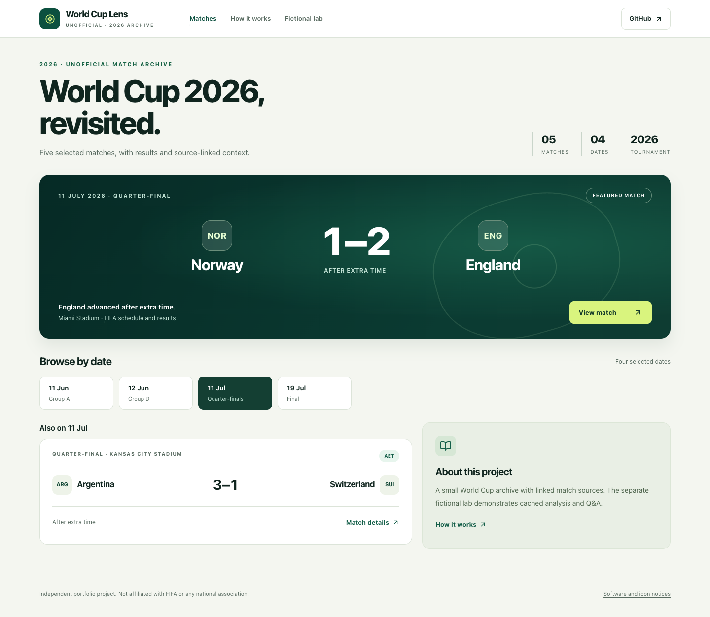

# World Cup Lens

World Cup Lens is a football archive built with **Next.js and TypeScript**. Browse five selected 2026 World Cup matches by date, read results and retrospective recaps, and follow links to the supporting sources. A separately labeled fictional lab demonstrates stored Match Lens commentary and preset Q&A.

**[Open the demo](https://world-cup-lens-one.vercel.app)** · [Fictional lab](https://world-cup-lens-one.vercel.app/?mode=illustrative&date=2026-06-11) · [Architecture](docs/architecture.md) · [Technical walkthrough](docs/technical-walkthrough.md) · [CI results](https://github.com/jeffreymutethia/world-cup-lens/actions)

The public demo runs without database credentials or paid API requests. Its editorial recaps are separate from the private Supabase/OpenAI pipeline. That backend provides versioned source documents, pgvector retrieval, structured model-output validation, immutable generation lineage and versioned caching.



[Mobile view](docs/screenshots/freeze-production/home-390.png) · [Match detail](docs/screenshots/freeze-production/detail-1280.png) · [Browser verification](docs/design.md#portfolio-freeze-browser-recheck--2026-11-04)

Production captures: November 4, 2026, revision `1472416`. [Release and screenshot evidence](docs/deployment.md).

## Engineering overview

| Area | Implementation |
| --- | --- |
| Application | Next.js 16.4.5 App Router, React 19, strict TypeScript, Tailwind, Radix UI and Lucide; server-rendered pages with small client components for navigation and stored Q&A |
| Historical replay | Versioned date-only records, four matchdays, source notes, extra-time labels and selection-preserving detail/back links |
| Private data layer | Supabase/PostgreSQL tables, foreign keys, atomic revision/cache writes, explicit grants and default-deny RLS |
| Retrieval | 1,536-dimensional pgvector cosine search, constrained by entity scope, source version and optional historical cutoff |
| Generation | OpenAI Responses structured-output adapters, Zod validation after proofreading and normalization, source manifests and immutable output history |
| Delivery | Deterministic TypeScript tests, disposable PostgreSQL/pgvector integration, HTTP and browser checks, GitHub Actions and Git-connected Vercel deployment |

The default `demo-only` policy blocks provider archive access and authoring/cron handlers before work. Only exact server-side `archive-enabled` opens the private integration boundary; authoring additionally requires an operator secret. Ordinary page rendering never generates or embeds content. No recurring cron is configured.

## Run locally

Use Node **22.13 or newer within major 22**; `.nvmrc` selects major 22.

```sh
npm ci
npm run dev
```

Open [localhost:3000](http://localhost:3000). The public demo requires no environment file. Missing or invalid deployment configuration defaults to `demo-only`.

```sh
npm test
npm run db:test
npm run test:replay-http
npm run test:demo-http
npm run lint
npm run typecheck
npm run build
npm run check:docs
npm run check:credentials
npm run check:security
git diff --check
```

`db:test` bootstraps, seeds, checks and destroys an isolated database using Docker PostgreSQL 17/pgvector 0.8.2 or an installed native PostgreSQL/pgvector setup. It accepts no remote database URL. `db:bootstrap` runs the same disposable bootstrap; it does not leave a persistent database. See [database setup](docs/database-contract.md#bootstrap-and-checks).

HTTP suites start local servers and must run sequentially. Archive checks use a Supabase mock; demo checks use a fetch-denial tripwire. `DEMO_TEST_PRODUCTION=1 npm run test:demo-http` tests the built server. Optional browser and authorized production smoke commands are described in the [release runbook](docs/deployment.md#verification-commands).

## Explore the system

- [Technical walkthrough](docs/technical-walkthrough.md): request paths and a synthetic match traced through code, SQL and tests.
- [Database contract](docs/database-contract.md), [security boundaries](docs/backend-security.md) and [retrieval design](docs/retrieval-design.md): schema, grants, RLS, vector filtering and cutoff semantics.
- [RAG pipeline](docs/rag-pipeline.md) and [engineering decisions](docs/engineering-decisions.md): validation, lineage, cache identity, transactions and failure recovery.
- [Interview guide](docs/interview-guide.md) and [portfolio summary](docs/portfolio-summary.md): technical explanations, tradeoffs and presentation material.
- [Audit](docs/audit.md#portfolio-freeze-audit) and [roadmap](docs/roadmap.md#portfolio-freeze-and-remaining-work): current findings, completed work and deferred improvements.

## Data and analysis boundaries

| Collection | Content | Runtime dependency |
| --- | --- | --- |
| Curated history | Five selected results, source metadata and original retrospective editorial context | Local repository records; public default |
| Fictional lab | Three invented scenarios with stored sample commentary and questions | Local synthetic records; explicit selection |
| Provider archive | Stored API-FOOTBALL fixtures and compatible cached AI commentary | Separately configured Supabase reads, subject to grants/RLS |
| Private authoring | Ingestion, document revisions, embeddings, retrieval and generation adapters | Protected operator workflow; model/embedding behavior tested with mocks |

Curated records preserve the reviewed source's local event day without inventing kickoff times or statistics. Fictional/provider timestamp selection uses America/Los_Angeles. No collection silently substitutes for another. [Source review](docs/curated-history-review.md) records the five results, primary URLs, evidence access methods and the Argentina–Switzerland event/publication-date discrepancy.

The publication decision covers only those five records and original commentary. Broader branding, redistribution and commercial-use questions remain unresolved; provider data and external excerpts retain UNKNOWN rights. No official logos, photos, article/PDF copies or provider exports are bundled. See [data rights](docs/data-rights.md) and [provenance](docs/data-provenance.md). The project is unofficial and is not affiliated with or endorsed by FIFA or any national association.

No repository code licence has been selected. [Licence options](docs/engineering-decisions.md#code-licence-decision-remains-with-the-owner) are documented separately from dataset/media permissions; existing dependency notices are retained in [third-party-notices.txt](public/third-party-notices.txt).

## Verification and limits

The portfolio-freeze release passed **70 unit tests**, **78 real PostgreSQL assertions**, local HTTP checks, lint, typecheck, build and hosted CI. Production HTTP checks covered all selected dates/details, source attribution, fictional Q&A and disabled routes. Chromium checks covered five viewport widths, keyboard navigation, focus and overflow. [Evidence and scope](docs/deployment.md#portfolio-freeze--verified-release).

The private backend is contract-tested, not a verified end-to-end production AI service. Complete Supabase gateway/Auth coverage, real-model grounding evaluation, production schema parity and durable recovery remain open. As-of filters enforce recorded availability assertions; they do not authenticate historical forecasts or model training cutoffs. Retrieved excerpts are context, not claim-level proof.

The November 4 dependency snapshot reported no production advisories and 8 moderate development-only lint/glob entries. CI checks known high/critical advisories on push/PR; this is not a security certification. [Current limitations](docs/audit.md#current-findings) distinguish private defects, engineering work and external rights/licence questions. The MVP is frozen to feature development; substantive correctness/security fixes remain permitted.
