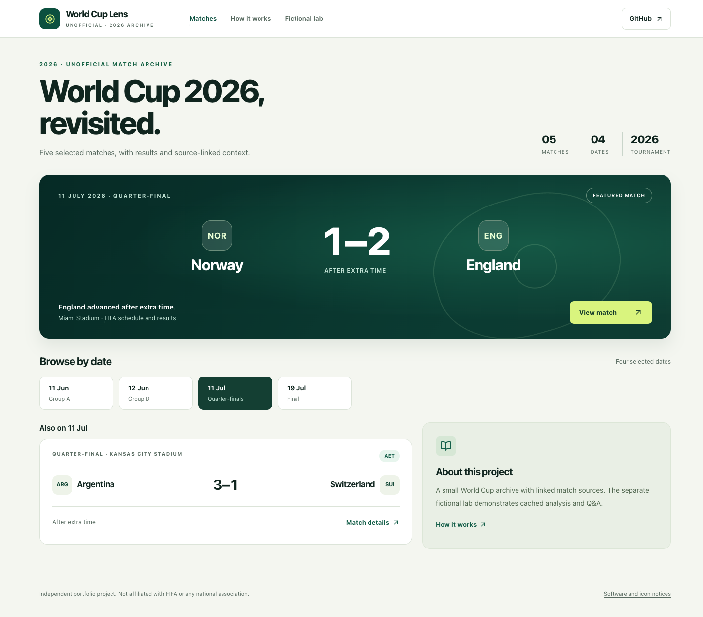
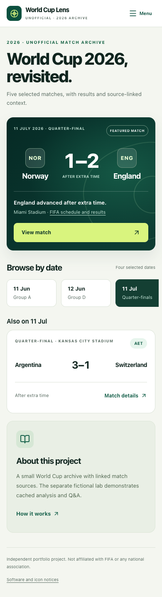

# World Cup Lens

An independent football engineering portfolio: **five independently curated 2026 World Cup matches** are the public centerpiece, with original retrospective context and primary source links. A separate **fictional AI lab** demonstrates cached Match Lens/Q&A presentation. A private Supabase archive and protected RAG authoring pipeline remain separate integrations.

**[Open the public replay](https://world-cup-lens-one.vercel.app)** · [Fictional lab](https://world-cup-lens-one.vercel.app/?mode=illustrative&date=2026-06-11) · [How it works](https://world-cup-lens-one.vercel.app/about)

Unofficial portfolio project. Not affiliated with, sponsored by or endorsed by FIFA or any national association. No official logos, photographs, crests, article text, PDF copies or provider exports are bundled.

## Historical selection

| Event day | Match | Stage | Final score |
| --- | --- | --- | --- |
| June 11, 2026 | Mexico–South Africa | Group A | 2–0 |
| June 12, 2026 | USA–Paraguay | Group D | 4–1 |
| July 11, 2026 | Norway–England | Quarter-final | 1–2 AET |
| July 11, 2026 | Argentina–Switzerland | Quarter-final | 3–1 AET |
| July 19, 2026 | Spain–Argentina | Final | 1–0 AET |

The initial public replay date is July 11. Four matchday tabs, a featured scoreboard and secondary fixtures and selection-preserving detail/back navigation work without credentials or a database connection. Details separate verified facts, original retrospective editorial context, source identity/link, evidence review/access date and explicit unknowns. AET means the final score includes extra time. No kickoff clock times, lineups, goal minutes, regulation-time breakdowns, player statistics, predictive ratings or tactical measurements are invented.

Sources and verification methods are in the [curated review](docs/curated-history-review.md). Two official PDFs were directly readable; three FIFA article/results entries were rechecked through indexed official evidence and federation cross-checks. Argentina–Switzerland preserves FIFA's explicit July 11 local event day separately from its July 12 article date and UEFA's differing July 12 entry.

Publication is an **owner-directed, narrowly scoped editorial release** of `wcl-curated-2026-v2`, not blanket FIFA permission, an open-data licence, definitive trademark clearance or permission to redistribute a provider database. Broader source/forking/branding and commercial-use questions remain unresolved. See [data rights](docs/data-rights.md). Unrelated historical/provider sources and cached AI corpus retain UNKNOWN rights.

## Run locally

Use **Node 22.13.0 or newer within major 22** (`.nvmrc`) and npm:

```bash
npm ci
npm run dev
```

Open [localhost:3000](http://localhost:3000). No environment file or service credential is required. Missing/unrecognized `WCL_DEPLOYMENT_MODE` fails closed to `demo-only`. An explicit production-style local run is:

```bash
WCL_DEPLOYMENT_MODE=demo-only npm run build
WCL_DEPLOYMENT_MODE=demo-only npm start
```

Curated records store date-only facts and preserve the reviewed source's local event day; they are not converted into fake kickoff timestamps. Fictional and private archive fixtures retain timestamp-based **America/Los_Angeles** day boundaries. Dates are validated strictly; empty selections, invalid dates, missing matches and query/validation errors have distinct messages. No dataset silently substitutes for another.

## Four distinct parts

| Part | Content and behavior |
| --- | --- |
| Curated history, `?mode=curated` | Five local date-only results and repository-authored retrospective editorial context; public demo default; no Match Lens generation or cache lookup |
| Fictional lab, `?mode=illustrative&date=2026-06-11` | Four synthetic teams, three scenarios on June 11–12, stored sample Lens/Q&A; no real results or actual pipeline run claimed |
| Supabase archive, `?mode=archive` | Stored provider fixtures and actual cached AI commentary; requires exact server setting `WCL_DEPLOYMENT_MODE=archive-enabled`; defaults to archive July 11 in that private setting |
| Private authoring pipeline | Ingestion → provider documents → chunks/embeddings → retrieval → structured generation/proofreading → cache; disabled in public deployments |

`demo-only` blocks archive reads, six admin POST routes and cron GET/HEAD before auth/work, even when credentials exist. No recurring cron is declared. The public UI never needs Supabase, OpenAI or API-FOOTBALL, and ordinary browsing never generates/embeds content. Exact `archive-enabled` is a server setting for separately configured local/private use, not a browser/URL override and not authorization to execute authoring.

## Stack and architecture

Next.js 16.2.9 App Router, React 19, strict TypeScript, Tailwind, Radix UI and Lucide. System fonts avoid Google build-time fetches. The original icon and licensed software/icon notices are served at `/icon.svg` and `/third-party-notices.txt`.

The retained backend uses Supabase Postgres, a pgvector retrieval RPC call, OpenAI embeddings and Responses structured outputs with Zod, and API-FOOTBALL ingestion. Disposable PostgreSQL/pgvector migrations, default-deny RLS and a reconstructed retrieval RPC are tracked and tested. New private authoring has immutable source/run lineage, final validation and gated cutoff filtering; no production migration has been applied. Old cached commentary has no authenticated historical cutoff and may rely on placeholder strengths. Context snippets are not claim-level citations. Cache modification time never becomes an analysis-generation timestamp or pre-match forecast.

Curated context was newly written during agent-assisted implementation and reviewed against selected facts. It is separate from the application's Match Lens generation pipeline. Fictional sample text is explicitly synthetic; private cached AI commentary remains unverified retrospective interpretation. No numerical Team Edges bars are presented as measured performance.

Read [architecture and Mermaid diagrams](docs/architecture.md), including a [worked Norway–England example](docs/architecture.md#curated-history-contract-and-worked-example), [provenance/time semantics](docs/data-provenance.md), [rights inventory](docs/data-rights.md), [audit](docs/audit.md) and [roadmap](docs/roadmap.md).

## Private archive configuration

```bash
WCL_DEPLOYMENT_MODE=archive-enabled npm run dev
```

Only this exact server opt-in enables archive access. Configure names in an ignored `.env.local` or authorized private deployment; never print/commit values:

| Variable names | Purpose |
| --- | --- |
| `NEXT_PUBLIC_SUPABASE_URL`, `NEXT_PUBLIC_SUPABASE_PUBLISHABLE_KEY` | Matching existing project URL/key for SELECTs, subject to grants/RLS |
| `SUPABASE_SECRET_KEY` | Server-only privileged operator client; not needed by public demo |
| `OPENAI_API_KEY`, optional `OPENAI_EMBEDDING_MODEL`, `OPENAI_MATCH_LENS_MODEL` | Private embedding/generation only |
| `API_FOOTBALL_KEY`, optional `API_FOOTBALL_BASE_URL`, `API_FOOTBALL_WORLD_CUP_LEAGUE_ID`, `API_FOOTBALL_WORLD_CUP_SEASON` | Private provider ingestion only |
| `WCL_AUTHORING_DATASET_VERSION` | Explicit dataset identity required with backend contract v1 before private authoring; not needed by demo |
| `ADMIN_GENERATION_SECRET`, `CRON_SECRET` | Existing operator gates, additionally disabled by demo-only policy |

Do not run ingestion, generation, embedding or cron as setup/smoke testing. Prior read-only verification of two real archive rows/joins/lenses establishes limited connectivity, not complete coverage, historical accuracy, stable uptime, RLS guarantees or publication rights. No provider data is copied into the curated module.

## Reproducible backend foundation

```bash
npm run db:test
npm run check:credentials
```

The database command bootstraps, seeds, checks and destroys an owned PostgreSQL/pgvector environment, with no production connection URL, real credentials or model calls. Docker uses isolated PostgreSQL 17/pgvector 0.8.2; installed native PostgreSQL with pgvector is also supported. Only original synthetic fixtures, deterministic vectors and mock outputs are used. `npm run db:bootstrap` is the same disposable smoke bootstrap, not a persistent database or production deployment.

The SQL is a reconstruction from application dependencies and limited read-only column discovery, **not** a production schema dump. Provider/source/vector/history rows default private; publishable clients cannot use this contract to expose provider data. Private authoring uses a privileged boundary. Generation records preserve inputs/source versions and cache history; an exact input attestation plus established publication/capture times gates as-of experiments. This does not authenticate old forecasts or guarantee model factuality.

Follow the [database contract and ER diagram](docs/database-contract.md), [role/security boundaries](docs/backend-security.md), [retrieval rules](docs/retrieval-design.md), and [RAG sequence, cache/failure flow and complete Maple–Harbor worked example](docs/rag-pipeline.md). Durable jobs, authenticated publisher evidence, grounding evaluation and an explicitly authorized production upgrade remain separate work.

## Verification

```bash
npm test
npm run lint
npm run typecheck
npm run build
npm run test:replay-http
npm run test:demo-http
DEMO_TEST_DEPLOYMENT_VALUE=invalid-value npm run test:demo-http
DEMO_TEST_PRODUCTION=1 npm run test:demo-http
```

HTTP suites run sequentially with localhost access, request/run deadlines and bounded child cleanup. Archive checks use a local mock Supabase. Demo checks clear service credentials, exercise all five results/four dates/detail attribution, fictional isolation, empty/invalid states and disabled methods with dummy secrets. An active fetch-denial tripwire verifies no application service requests on these local paths. This is not complete production infrastructure egress monitoring.

[GitHub Actions](.github/workflows/ci.yml) uses pinned official actions, Node 22, `npm ci`, read-only permissions, no real credentials and explicit deadlines for tests/lint/typecheck/build/HTTP/whitespace checks, plus a separate disposable PostgreSQL/pgvector integration job. [Hosted results](https://github.com/jeffreymutethia/world-cup-lens/actions) are verified separately from local checks.

Optional real-browser QA uses an existing Chromium installation, a temporary profile and no additional dependencies. Start a demo-only production build on localhost port 3107, then run `npm run test:design`. `CHROMIUM_PATH` selects an already installed binary; `DESIGN_CAPTURE_DIR` selects the capture directory. The script does not install a browser or attach to your profile. It is separate from hosted CI.

`npm run test:production-http` explicitly checks the authorized public URL with bounded unauthenticated requests. It verifies demo policy before disabled admin/cron method checks; it never sends real secrets or executes authoring. Do not point this command at an archive-enabled/private deployment.

## Deployment and screenshots

Existing Vercel project `jt254/world-cup-lens` tracks `main`, Next.js at repository root, Node 22 and only non-secret `WCL_DEPLOYMENT_MODE=demo-only`; no service credentials or recurring cron are needed. [Deployment evidence](docs/deployment.md) separates revision-specific CI/deployment, public HTTP and browser QA from implementation claims.

The editorial redesign follows the supplied desktop/mobile direction: one responsive header, a forest-green scoreboard, four matchday tabs, short recaps and source notes. The featured match is never repeated in the secondary listing. The fictional lab stays separate. See [design decisions and visual evidence](docs/design.md).

Production captures from 2026-11-04, runtime `1bf320c`, using isolated headless Chromium. These are genuine application screenshots, not the supplied mockups. [Full five-width matrix, interaction checks and limits](docs/design.md).





[Desktop match detail](docs/screenshots/redesign-production/detail-1280.png) · [320-pixel detail](docs/screenshots/redesign-production/detail-320.png) · [Visible keyboard focus](docs/screenshots/redesign-production/home-390-keyboard-focus.png)

Remaining work: broaden accessibility/browser checks, maintain source evidence/review versions, assess rights before broader reuse, track reproducible database contracts/RLS, and repair upstream placeholder inputs and immutable historical lineage. No production-readiness or legal-clearance claim is made.
