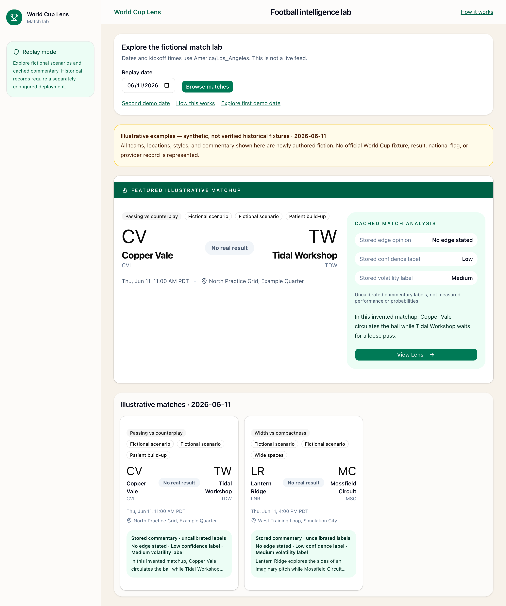
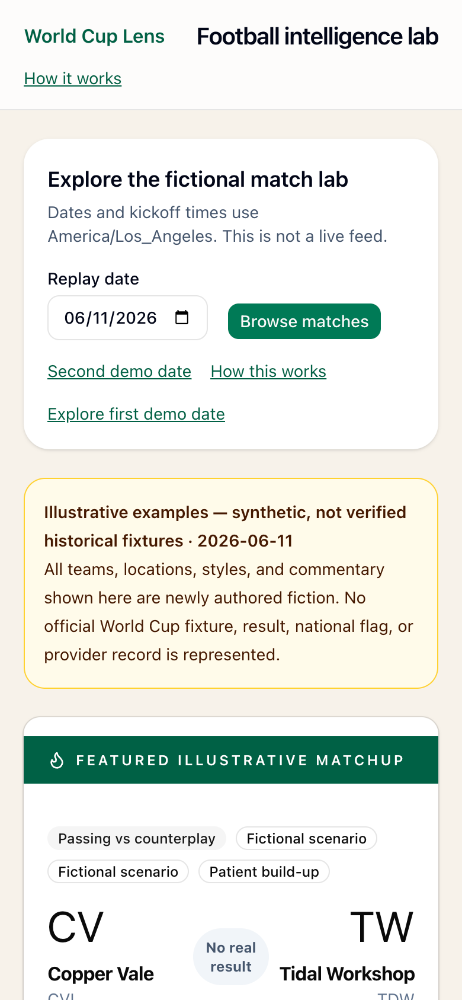

# World Cup Lens

A football intelligence portfolio application with a **self-contained fictional match lab** and a separate historical-archive integration. It demonstrates date-based browsing, a featured matchup, cached commentary, preset Q&A, honest provenance labels, and a guarded authoring architecture.

**[Open the public demo](https://world-cup-lens-one.vercel.app)** · [How it works](https://world-cup-lens-one.vercel.app/about)

**Default deployment: demo-only.** No database, Supabase key, OpenAI key, API-FOOTBALL key, or paid request is needed to browse it. The examples are newly authored fiction, not official World Cup fixtures or results. No public historical dataset export is approved.

## Run the demo

Use **Node 22.13.0 or newer within major 22** (`.nvmrc`) and npm:

```bash
npm ci
npm run dev
```

Open [localhost:3000](http://localhost:3000). No environment file is required. Missing or unrecognized `WCL_DEPLOYMENT_MODE` values fail closed to `demo-only`. For an explicit public configuration:

```bash
WCL_DEPLOYMENT_MODE=demo-only npm run build
WCL_DEPLOYMENT_MODE=demo-only npm start
```

June 11 shows Copper Vale–Tidal Workshop and Lantern Ridge–Mossfield Circuit; June 12 shows another fictional scenario. Open a match, read its stored sample story, and switch between cached questions. Date/card/back links preserve the selection. [How it works](http://localhost:3000/about) explains the architecture. Numerical strength comparisons are unavailable, and no real result is invented.

The new `wcl-synthetic-v1` examples contain no provider exports, external excerpts, country flags, real-team claims, or sports logos. See the scoped [publication review](docs/demo-publication-review.md). Earlier UNKNOWN sources were not automatically approved; old examples remain in Git history and are not cleared by replacing the current files.

## Two deployment boundaries

| Server setting | Public behavior | Service/authoring behavior |
| --- | --- | --- |
| `WCL_DEPLOYMENT_MODE=demo-only` (also missing/invalid) | Reviewed illustrative module only; engaging June 11 default; no archive selector; explicit archive URLs show a disabled state | Archive readers are not called. All six admin POST handlers and cron GET/HEAD return 404 before auth/work, even if credentials exist. |
| `WCL_DEPLOYMENT_MODE=archive-enabled` | Historical archive retains its original meaning/default July 11, plus explicit fictional examples | Requires separately configured Supabase reads. Existing secret gates protect retained authoring endpoints; enabling the mode does not authorize running them. Intended for local/private operation until historical rights and deployment gates are resolved. |

The flag is server-side, not `NEXT_PUBLIC_`, not a URL switch, and not a browser setting. Set it consistently at build/start/deployment. The public application is decoupled from Supabase because an unavailable database, a paid API, or an uncleared dataset should not be a prerequisite for demonstrating UI and engineering decisions. Ordinary browsing never generates or embeds content in either mode.

Explicit `?mode=archive` is rejected in demo-only mode; it is never silently changed into illustrative data. Valid empty dates, invalid input, missing matches, unavailable commentary, and query failures have separate messages. Fixture-day boundaries and kickoff display use **America/Los_Angeles** rather than the current date.

## Stack and architecture

Next.js 16.2.9 App Router, React 19, strict TypeScript, Tailwind CSS, Radix UI, and Lucide. Typography uses system fonts. Dependency/icon notices are served at `/third-party-notices.txt`; the favicon is an original geometric SVG.

The retained historical backend uses Supabase Postgres, an intended pgvector retrieval RPC, OpenAI embeddings/Responses structured outputs with Zod, and API-FOOTBALL ingestion. Its separate path is fixtures → normalized rows → documents → chunks/embeddings → retrieval → structured generation → cache. These operator features are disabled in the public demo and are not needed to build/test it.

See [architecture and Mermaid diagrams](docs/architecture.md), [provenance/time contract](docs/data-provenance.md), [rights inventory](docs/data-rights.md), [audit](docs/audit.md), and [roadmap](docs/roadmap.md).

## Archive setup — separately configured local/private use

```bash
WCL_DEPLOYMENT_MODE=archive-enabled npm run dev
```

Only this explicit server setting enables archive access. Configure these names in an ignored `.env.local` or authorized private deployment configuration; never print or commit values:

| Variable names | Purpose |
| --- | --- |
| `NEXT_PUBLIC_SUPABASE_URL`, `NEXT_PUBLIC_SUPABASE_PUBLISHABLE_KEY` | Matching existing project URL/key for archive SELECTs; grants/RLS determine readable rows. |
| `SUPABASE_SECRET_KEY` | Server-only privileged operator access, not a public demo requirement. |
| `OPENAI_API_KEY`, optional `OPENAI_EMBEDDING_MODEL`, `OPENAI_MATCH_LENS_MODEL` | Retained embedding/generation configuration; never called by ordinary browsing. |
| `API_FOOTBALL_KEY`, optional `API_FOOTBALL_BASE_URL`, `API_FOOTBALL_WORLD_CUP_LEAGUE_ID`, `API_FOOTBALL_WORLD_CUP_SEASON` | Retained provider ingestion configuration. |
| `ADMIN_GENERATION_SECRET`, `CRON_SECRET` | Existing operator endpoint gates, additionally disabled by demo-only mode. |

Do not supply service keys to a public demo. Do not invoke ingestion, generation, embedding, or cron as a setup/smoke-test step. `vercel.json` declares no recurring cron. No migrations or database bootstrap are yet tracked. A publishable read does not verify full RLS, write restrictions, or historical correctness.

A prior read-only check of the existing project verified two July 11 fixtures/joins/lenses and local rendering after a DNS/HTTP 521 availability transition. This is limited evidence, not a public data license, guaranteed uptime, or an approved historical deployment. Archive errors remain truthful; no provider data is copied into the demo.

## Verification

```bash
npm test                   # deterministic TypeScript/Node cases
npm run lint
npm run typecheck          # Next typegen + TypeScript
npm run build
npm run test:replay-http    # archive-enabled, local mock Supabase only
npm run test:demo-http      # unset policy, empty service credentials, fetch-denial tripwire
DEMO_TEST_DEPLOYMENT_VALUE=invalid-value npm run test:demo-http
```

HTTP suites require localhost sockets and no other Next dev server in this checkout. They enforce request/run deadlines and clean up owned process groups. The demo suite exercises default/date/detail/Q&A/about/empty/invalid/missing states, rejects archive requests, and proves all authoring handlers are blocked with matching dummy secrets. The active tripwire rejects service fetches before network access; no real API credentials or production database are used. `DEMO_TEST_PRODUCTION=1 npm run test:demo-http` checks a completed production build.

[GitHub Actions](.github/workflows/ci.yml) runs push/PR checks on Node 22 with `npm ci`, unit tests, lint, typecheck, build, both HTTP suites, production-server demo checks, invalid-flag isolation, and committed/generated whitespace checks. Official actions are pinned, permissions are read-only, no secrets are supplied, and steps/job have deadlines. [Hosted workflow results](https://github.com/jeffreymutethia/world-cup-lens/actions) are distinct from local evidence.

## Production screenshots

Captured from the public domain in Chrome on 2026-11-03; desktop/mobile captures show the responsive fix in `a8150be`. These show fictional examples only. [QA evidence and scope](docs/deployment.md).

<details>
<summary>Desktop and mobile captures</summary>





[320-pixel featured-card capture](docs/screenshots/production-mobile-320.png) · [Visible keyboard focus on cached questions](docs/screenshots/production-keyboard-focus.jpg)

</details>

## Interpretation and remaining limits

Public sample commentary is authored fiction, not a model response or scouting report. Its fixture times are navigation examples and its dataset version is explicitly `wcl-synthetic-v1`. In archive mode, cached AI text stays retrospective: publication/capture/generation times, historical knowledge cutoff, and database dataset version are unknown. A cache update is never converted into a pre-match forecast. Context snippets are not claim-level citations, and hidden placeholder metrics can still have influenced old commentary.

Historical provider/derived-source rights remain UNKNOWN. Public GitHub historical exports remain NOT_APPROVED; historical web display requires review. The separate original-demo decision is limited to the newly authored content and reviewed assets, not all repository history or third-party marks. The user's project name is not a claim of official tournament affiliation.

**Deployment:** the existing `jt254/world-cup-lens` Vercel project serves [world-cup-lens-one.vercel.app](https://world-cup-lens-one.vercel.app). The first production release of `8299114` was verified on 2026-11-03. Production tracks `main`, uses Next.js at the repository root, Node 22 and `WCL_DEPLOYMENT_MODE=demo-only`, and needs no service credentials. Project cron execution is disabled and no schedule is declared. See [deployment and QA evidence](docs/deployment.md) for commit-specific verification and limits.

`npm run test:production-http` checks this public demo with bounded, unauthenticated requests, including disabled admin/cron responses; it never sends service secrets. Use `DEMO_URL=https://your-verified-demo.example npm run test:production-http` only for another authorized demo-only release. This is an explicit remote check, separate from credential-free local CI.

Next work: establish reproducible backend/source lineage and rights before historical publication, broaden browser/accessibility coverage and maintain deployment verification. See the [roadmap](docs/roadmap.md).
