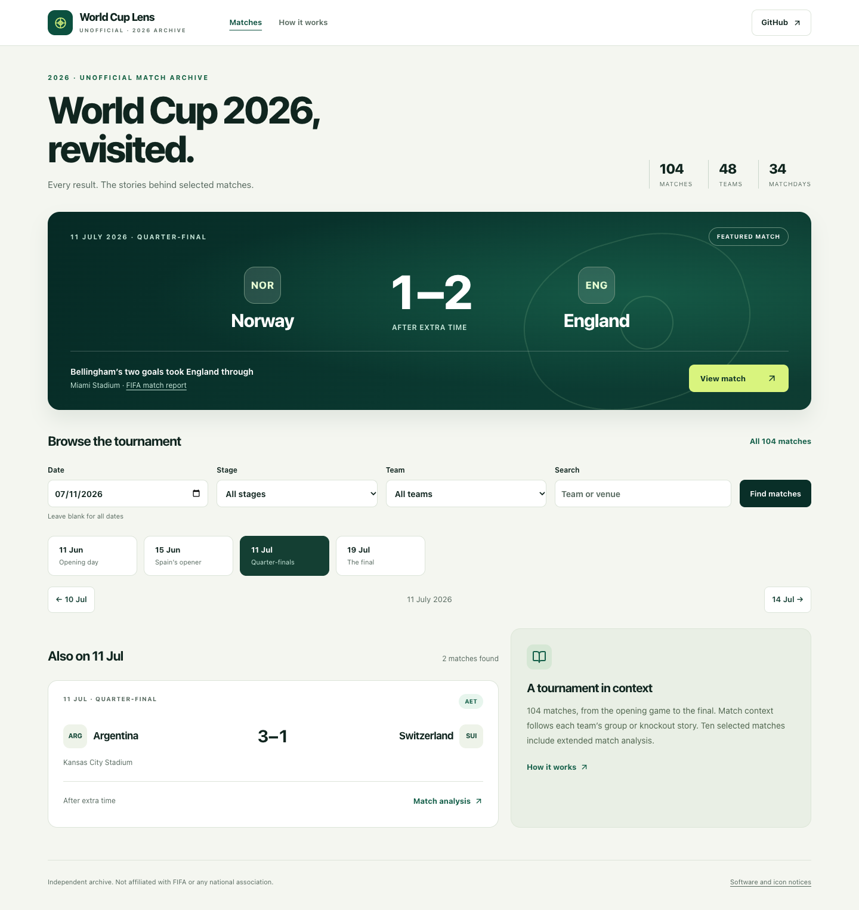

# World Cup Lens

World Cup Lens is an independent archive of **all 104 matches of the 2026 World Cup**, built with Next.js and TypeScript. Browse by date, stage, group or team, then open a Match Lens for the result, tournament context and supporting sources. The archive distinguishes 94 concise **Match context** pages from ten extended **Match analysis** retrospectives.

**[Explore World Cup Lens](https://world-cup-lens-one.vercel.app)** · [All results](https://world-cup-lens-one.vercel.app/?mode=curated&date=all) · [Architecture](docs/architecture.md) · [Technical walkthrough](docs/technical-walkthrough.md) · [CI](https://github.com/jeffreymutethia/world-cup-lens/actions)

The public archive is self-contained: no database connection, paid API calls or request-time model generation. Its editorial Match Lenses are separate from the private Supabase/OpenAI infrastructure, which provides semantic retrieval, temporal eligibility, structured-output validation and immutable generation history.



[Mobile archive](docs/screenshots/maintenance/home-390.png) · [Match Lens detail](docs/screenshots/maintenance/detail-1280.png) · [Local browser checks](docs/screenshots/maintenance/qa-local.json)

Local maintenance-candidate captures, November 7, 2026. [Release verification](docs/deployment.md) records the separately verified production revision.

## Explore the archive

The homepage opens on July 11, featuring Norway–England. Use the calendar, stage/group and team controls, or search by team or venue. Leave the date blank to search the whole tournament; full results are paged rather than placing 104 cards on the homepage.

Every match page includes retrospective context or analysis, official source links, evidence notes and team journeys. Group records are calculated from reviewed results through the selected match, without inferring official table positions or qualification tiebreakers. Shootout scores are shown separately from match goals. Dates remain date-only; no kickoff instant is invented. Match URLs use the destination’s actual event day; separate return filters preserve the original list and page. Match-specific titles, descriptions, Open Graph fields and canonical links use public facts only.

The former fictional public lab is retired. Old illustrative URLs redirect to the historical homepage. Original synthetic fixtures remain in isolated tests; private provider data is never substituted into public results.

## Engineering overview

| Area | Implementation |
| --- | --- |
| Application | Next.js 16.4.5 App Router, React 19, strict TypeScript, Tailwind, Radix UI and Lucide; server-rendered URL filters with a small client component for mobile navigation |
| Public data | 104 numbered, versioned records; 48 consistent team identities; explicit result/AET/shootout semantics; source metadata and ten extended editorial Lenses |
| Private data layer | Supabase/PostgreSQL, foreign keys, atomic revision/cache writes, explicit grants and default-deny RLS |
| Retrieval | 1,536-dimensional pgvector cosine search with entity scope, source versions and optional historical cutoff eligibility |
| Generation | OpenAI Responses structured-output adapters, final Zod/team validation, source manifests and immutable output history |
| Cache | Deterministic input/source/prompt/model identity; versioned cache and atomic run/cache commits |
| Verification | Deterministic unit tests, disposable PostgreSQL/pgvector integration, mock HTTP, service-isolation checks and GitHub Actions |

The default `demo-only` server policy blocks private provider reads and all authoring/cron handlers before work. Exact server-side `archive-enabled` remains an opt-in for separate local/private operation; authoring additionally requires operator authentication. Archive reads remain subject to database grants/RLS. The public Vercel deployment must keep private services disabled. `vercel.json` has no recurring schedule.

## Run locally

Use Node **22.13 or newer within major 22**; `.nvmrc` selects major 22.

```sh
npm ci
npm run dev
```

Open [localhost:3000](http://localhost:3000). No environment file or service credentials are needed for the public archive.

```sh
npm run check:data
npm test
npm run db:test
npm run test:replay-http
npm run test:demo-http
npm run lint
npm run typecheck
npm run build
npm run check:docs
npm run check:credentials
npm run check:security
git diff --check
```

`check:data` verifies the offline tournament manifest. Unit tests also pin reviewed factual tuples, bracket pairings, filters, source contracts and result handling. Neither command independently fetches or authenticates publisher evidence.

`db:test` creates, seeds, tests and destroys its own PostgreSQL/pgvector instance using Docker or an installed native setup. It accepts no remote database URL. HTTP suites own local servers and must run sequentially: the private archive uses mock Supabase responses; public browsing runs with empty service settings and a fetch-denial tripwire. `DEMO_TEST_PRODUCTION=1 npm run test:demo-http` checks the built server. Optional browser and authorized production checks are documented in the [release runbook](docs/deployment.md#verification-commands).

Source availability can be checked separately:

```sh
npm run check:sources -- --limit 3
```

This manual, bounded check tries HEAD, then a single-byte Range GET only when HEAD is unsupported, and cancels response bodies. It distinguishes missing, blocked and failed requests. Publisher failures are report-only by default; `--strict` opts into a failing exit code. It never changes historical facts or runs external checks during ordinary CI. A successful response is reachability evidence, not renewed factual or rights verification.

## Explore the implementation

- [Technical walkthrough](docs/technical-walkthrough.md): concrete public request paths and a synthetic match traced through private code, SQL and tests.
- [Database contract](docs/database-contract.md), [security](docs/backend-security.md) and [retrieval](docs/retrieval-design.md): reconstructed schema, RLS/grants, vector/entity/cutoff semantics.
- [RAG pipeline](docs/rag-pipeline.md) and [engineering decisions](docs/engineering-decisions.md): validation, cache identity, lineage, transactions and failure recovery.
- [Source review](docs/curated-history-review.md), [provenance](docs/data-provenance.md) and [rights](docs/data-rights.md): evidence, publication scope and unresolved boundaries.
- [Audit](docs/audit.md#current-findings), [roadmap](docs/roadmap.md), [interview guide](docs/interview-guide.md) and [portfolio summary](docs/portfolio-summary.md).

## Sources and boundaries

All 104 factual records were checked against directly read official match-report PDF first pages, with official results hubs corroborating scores and shootouts. Source URLs and review dates accompany every record. Publisher prose, PDFs and media are linked rather than bundled; the dataset is not an API-FOOTBALL export. Original recaps distinguish reported developments from interpretation and missing evidence.

The owner-directed publication decision covers this noncommercial editorial archive and its original commentary. It is not a blanket FIFA permission, an open-data licence or definitive branding clearance. Database rights, source distribution and broader commercial use remain subject to their own context. Private provider data, excerpts and cached AI output retain UNKNOWN rights. The project is unofficial and not affiliated with FIFA or any national association.

No repository code licence has been selected. [Licence options](docs/engineering-decisions.md#code-licence-decision-remains-with-the-owner) remain separate from dataset/media permissions; [dependency notices](public/third-party-notices.txt) are retained.

## Verification and limitations

Release-specific local, CI, database, browser and production results are recorded in [deployment evidence](docs/deployment.md). The public archive does not claim live RAG, calibrated predictions or authenticated pre-kickoff forecasts.

The private backend is a tested contract foundation, not a fully verified production AI service. Complete Supabase gateway/Auth coverage, production schema parity, durable recovery and real-model grounding evaluation remain open. Cutoffs enforce recorded availability assertions; retrieved context does not prove every generated claim. Broader accessibility and cross-browser checks are also deferred. See the [remaining work](docs/roadmap.md).
