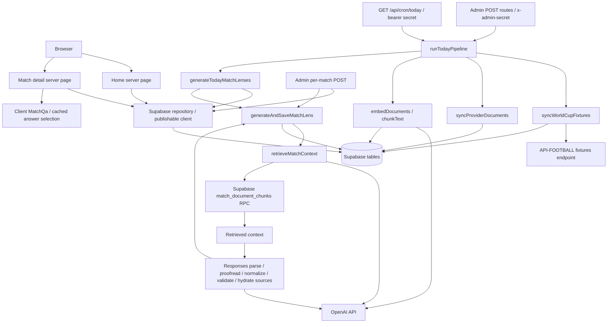
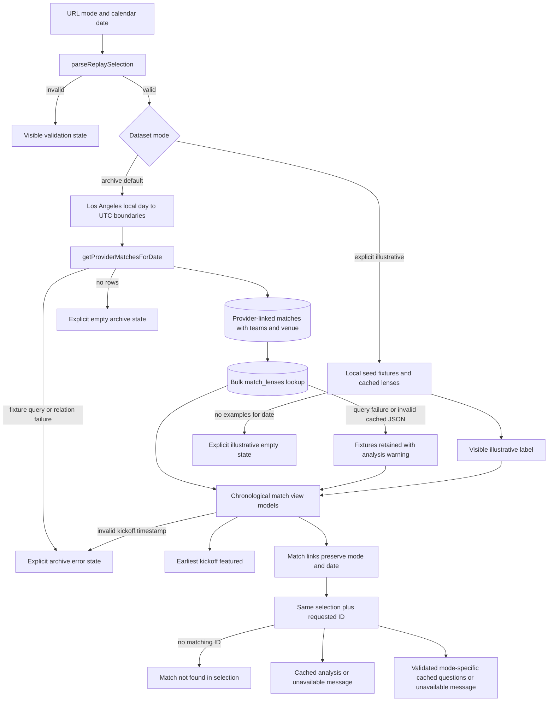
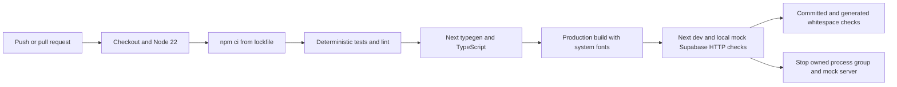

# Verified current architecture

Architecture inspected 2026-11-02; connectivity and CI follow-up verified 2026-11-03. This describes repository code, not an exercised deployment. The first public historical replay milestone is implemented; backend provenance and reproducibility remain incomplete. Database schema, pgvector extension/indexes, RPC SQL, RLS policies, deployed resources, and complete stored-data coverage remain unverified: no SQL/migrations or infrastructure definitions establishing them are tracked.

## Components and flow

Other admin POST routes invoke fixture sync, provider document sync, embedding, or today's generation individually. RPC internals are not present; the diagram asserts the call, not its SQL implementation.

## Public reads and UI

`src/app/page.tsx:Home` awaits Next.js 16 promise-based `searchParams` (a request-time API). `src/lib/replay.ts:parseReplaySelection` accepts `mode=archive|illustrative` and a strict `YYYY-MM-DD` date within the configured tournament browse range, June 11–July 19, 2026. Missing archive dates default to July 11, 2026; missing illustrative dates default to June 11. Duplicate or invalid parameters produce a visible validation state without querying the database. July 11 is a requested starting selection, not an assertion that the database contains that day's fixtures. Missing data remains visibly empty; no alternate dataset or date is substituted.

`getProviderMatchesForDate` in `src/lib/supabase/repository.ts` reads only API-FOOTBALL-linked fixtures between Los Angeles local midnight and the next local midnight, with a half-open UTC interval. `dateBounds` computes each midnight independently, including daylight-saving changes; it never treats a bare date as a UTC instant and then converts to a local date. Joined teams/venues and a bulk cached-lens read populate `MatchViewModel`. Missing relations cause an error rather than silently omitting fixtures. Lens query errors retain fixture details with `lensState=unavailable`; malformed Lens JSON becomes `lensState=invalid`. Both show a cache warning rather than blanking the date. `src/lib/cached-analysis.ts` validates displayed strings, arrays, enum values, and snippet shape against `PublicMatchLens`, without generation-length constraints. PublicMatchLens excludes unsupported numerical edges; absent/malformed legacy edge fields are not consumed or rewritten, so they do not erase useful qualitative copy. The full legacy `MatchLens` storage/generation contract remains unchanged. Existing today-based ingestion/generation callers retain `getProviderMatchesForLocalDate` and its live-first ordering; public replay does not use that real-clock default.

`loadReplay` is the shared testable selection service: archive calls its injected date reader; illustrative reads the existing local seed helpers. It rejects malformed kickoff timestamps as a data error, checks the selected day's boundaries and chooses the earliest kickoff as featured, with an ID tie-breaker. Ready, empty, and query-error results are distinct. Errors are not logged or exposed with provider details. `src/app/loading.tsx` supplies a loading state. A GET form in `ReplayControls` makes date/mode selection bookmarkable; card and back links use `replayHref` to preserve both values. Direct detail links without parameters use the same fixed defaults, so a match outside the default date requires an explicit date in its URL.

`src/app/matches/[id]/page.tsx:MatchPage` selects the requested ID from that same dataset/day result, preventing seed/archive crossovers and wrong-date details. An unmatched ID displays a useful selection-specific message (not a dedicated HTTP 404). Failed archive reads display an error, not a not-found claim. Missing cached Lens rows still render fixture details. `loadReplayAnswers` reads either seed answers or Supabase `qa_answers`; a failed Q&A query or malformed answer payload does not hide the fixture/Lens. There is no public generation or provider-fetch action: ordinary rendering reads Supabase and local examples only, without OpenAI or API-FOOTBALL calls. Database reads still require configured Supabase access; this is not yet a bundled offline historical dataset.

`AppShell` composes the replay sidebar and header. Nonfunctional navigation/search/notification/filter controls and synthetic zero standings are removed from the public surface; their unused standings component remains tracked. `MatchQa` selects cached answers using client state; no question-generation endpoint exists. `MatchLensCards` withholds numerical Team Edges in both modes and retains qualitative sections plus an unavailable comparison card. Confidence/volatility/edge values are labeled stored, uncalibrated opinions; null edge does not imply equality. Lens/Q&A snippets are labeled stored context (illustrative context examples in synthetic mode) and explicitly not claim-level citations, with an empty-context fallback. Q&A is presented as cached exploration. Tailwind, Radix, and Lucide retain the existing visual design. Layout metadata identifies historical replay. `src/app/globals.css` uses system sans-serif and monospace font stacks; layout has no Google font import or font download requirement. This trades exact Geist typography for offline build reliability without redistributing font binaries.

### Replay selection and cache flow

Archive is the default to avoid presenting synthetic football as history. Illustrative examples require explicit selection and are labeled on both screens. All archive analysis is presented retrospectively, and synthetic commentary has a distinct origin label: stored model/update fields do not establish source publication times or a pre-kickoff knowledge boundary. Cached prose is retained rather than regenerated or rewritten as fact. `replayStatus` never treats stored intermediate status/elapsed fields as current live evidence. `replayScore` shows a score only for recorded FT/AET/PEN status and two nonnegative integer scores; missing or intermediate results stay unavailable, with no invented zero. Stage labels prefix only single group letters; the underlying stage/group schema remains unchanged. Shootout breakdowns are not reconstructed.

## Ingestion and persistence

`src/lib/fixtures/api-football.ts:fetchWorldCupFixtures` fetches `/fixtures` with league/season defaults `1`/`2026`, API key header, and `cache: "no-store"`. `normalizeApiFootballFixture` maps provider fixtures to team, venue, and match records. `syncWorldCupFixtures` deduplicates by application ID and sequentially upserts `teams`, `venues`, and `matches` using the privileged client. Team IDs are name slugs; codes append external IDs. Strengths are all 50. Venue country comes from league country; round becomes `group_name` when it is not a group. Canonical status is always `scheduled`; provider statuses and goals are stored separately. Raw responses and extra-time/penalty breakdowns are not persisted by this writer.

`src/lib/documents/sync-provider-documents.ts:syncProviderDocuments` synthesizes team/venue profiles from provider-linked rows. It reuses the first existing entity/profile document ID or creates a UUID and upserts `documents` with null source URLs. No external article crawler or file-upload ingestion is implemented here.

`src/lib/documents/embed-documents.ts:embedDocuments` reads all documents, chunks each body using `chunkText` (1,200 characters, 180 overlap), embeds per document, deletes old chunks, then inserts replacements into `document_chunks`. Metadata contains title/type/source URL/entity IDs. `src/lib/ai/embeddings.ts` defaults to `text-embedding-3-small`, checks output counts for batches, and orders by response index. No incremental hash/version skip or atomic chunk swap exists.

## Retrieval, generation, and caching

`retrieveMatchContext` embeds a team/group/venue query and calls `match_document_chunks` with threshold 0.15, count 8, team IDs, venue ID, and match ID. It has no historical cutoff argument. Database-side filter semantics and vector dimensions cannot be verified locally.

`generateMatchLens` defaults to `gpt-5-mini`, rejects empty context, and allows two application generation attempts. Each attempt calls Responses `parse` with `MatchLensSchema`, then another Responses call in `proofreadMatchLens`. Copy normalization and a small suspicious-word pattern list follow. `hydrateLensSources` replaces model sources with title-deduplicated retrieved snippets; this attaches retrieval context, not claim-level citation proof. The final transformed object is not re-parsed against the schema. Prompt restrictions are stronger than some programmatic checks (for example edge order/values and allowed slight-edge team names).

`generateAndSaveMatchLens` upserts one `match_lenses` row per match containing JSON, model, and update timestamp. Today's generation skips existing rows unless `refresh=true`; it selects only today's live/upcoming matches and processes sequentially. This is database output caching, without source/prompt/model-version invalidation or historical snapshots. `qa_answers` are read, but no writer is tracked. No explicit Next cache/revalidation policy is configured; `next.config.ts` is empty apart from its exported object.

## Operations and trust boundaries

`src/lib/supabase/server.ts:createServerSupabaseClient` uses public URL/publishable key, without session persistence. `admin.ts:createAdminSupabaseClient` uses `SUPABASE_SECRET_KEY`. Both are server-only; `src/lib/ai/openai.ts` constructs the OpenAI client using `OPENAI_API_KEY`.

All six admin routes require a configured `ADMIN_GENERATION_SECRET` equal to `x-admin-secret`; cron requires `Authorization: Bearer <CRON_SECRET>`. Missing secrets deny access. `vercel.json` no longer declares a recurring cron. The protected cron route remains available for explicitly authorized operation; existing remote deployment schedules have not been changed or verified. Deployment runtime limits remain unverified. `runTodayPipeline` sequentially performs fixtures → provider documents → embeddings → lenses, reports completed steps and failures, and does not roll back earlier writes. No tracked queue, persistent run ledger, concurrency lock, or duration configuration exists.

Environment names: Supabase URL/publishable/secret keys above; OpenAI key plus optional `OPENAI_EMBEDDING_MODEL`/`OPENAI_MATCH_LENS_MODEL`; `API_FOOTBALL_KEY` plus optional `API_FOOTBALL_BASE_URL`, `API_FOOTBALL_WORLD_CUP_LEAGUE_ID`, `API_FOOTBALL_WORLD_CUP_SEASON`; admin/cron secrets above. Values were not inspected. `.gitignore` excludes `.env*` and `.vercel`; no tracked environment template, database bootstrap, or licensing manifest exists. CI is now tracked in `.github/workflows/ci.yml`. `package.json` provides dev/build/start/lint, `npm run typecheck` (`next typegen` then TypeScript without emitting), and `npm test`. `scripts/test.mjs` compiles `tests/replay.test.ts` and its pure TypeScript dependencies using the installed compiler and `tsconfig.test.json`, runs Node’s test runner in a temporary directory, and removes generated output. Tests inject archive readers and use deterministic local examples; no network credentials are needed. `npm run test:replay-http` also starts a local mock Supabase endpoint and Next dev server, overrides database/provider/OpenAI credentials with dummy values in the child process only, and checks rendered HTML for archive/illustrative/empty/error/invalid/detail states, query boundaries, and missing cached analysis. It requires localhost sockets and an available Next dev lock, not a remote database. Per-request deadlines are 15 seconds; a 120-second watchdog and bounded process-group TERM/KILL cleanup prevent stalled Next child processes retaining sockets on macOS/Linux. This is HTTP rendering verification, not visual browser verification. See [audit](audit.md) for validation results and [roadmap](roadmap.md) for proposed changes.

## Delivery verification and deployment gate

The reviewed replay milestone passes local tests/builds; the CI/documentation follow-up adds an explicit Node 22.13+ engine floor, `.nvmrc` major 22, and the same checks on GitHub Actions. System fonts avoid font downloads. Local or mock results do not establish historical accuracy, complete source lineage, or production deployment readiness.

On 2026-11-03, the configured Supabase URL passed HTTPS, hostname, root-path, and no-userinfo/query/fragment checks. Its canonical project URL was confirmed in the existing authorized dashboard; no alternative URL or credential was copied. The project first failed independent A/AAAA/OS DNS checks (`ENOTFOUND`), then resolved but returned HTTP 521. The dashboard showed “Coming up…” and recent failing readiness/health requests. Later read-only requests succeeded without agent changes to project state, environment files, schema, or data. This is evidence of an availability/startup transition; the original trigger (including whether previously paused) was not established. The project exists; deletion or a mistyped configured URL is not supported by the observed dashboard.

Publishable-key SELECTs returned two July 11 fixtures in the Los Angeles UTC interval, complete home/away/venue joins, two cached Lens rows, and zero cached questions for the selected detail. Actual homepage, explicit-date listing, and one detail rendered locally with those rows and cached analysis. These reads confirm permitted public access to the tested rows only, not the full RLS/grant configuration, write restrictions, or all tournament dates. No raw provider records or keys were published.

No local `.vercel/project.json`, Vercel CLI, project/org environment identifiers, or deployment token was available during inspection. An existing remote project/integration may exist, but has not been identified through an authorized connection. Deployment remains gated on identifying that existing project, verifying its configuration and data/rights limitations, and confirming no scheduled ingestion. No public production URL or deployed smoke-test success is claimed.

## Credential-free CI

`.github/workflows/ci.yml` runs on `push` and `pull_request`, using Ubuntu 24.04 and Node major 22 from `.nvmrc`. Checkout/setup-node actions are pinned to official commit SHAs; checkout credentials are not persisted, and workflow permissions are `contents: read`. `npm ci --no-audit --no-fund` uses the existing lockfile. The job runs deterministic tests, lint, route-type generation/TypeScript checking, production build, mock HTTP checks, and committed/generated whitespace validation. All steps have deadlines inside a 15-minute job limit. Supabase points at an unusable loopback URL; paid/provider/admin secrets are empty. The HTTP harness supplies its own local mock URL and dummy credentials. No secret contexts, live database, service role, paid API, cron, or deployment operation is part of CI.

The workflow does not test a real database or deployment and does not replace backend integration, browser interaction, or RLS verification. The README documents a credential-free illustrative path and separates it from archive/operator configuration.

## Analytical presentation and provenance boundary

`src/lib/analysis-presentation.ts:analysisPresentation` supplies mode-specific commentary/context labels and a policy that numerical comparisons are not available. It does not inspect whether values equal 50 or infer credibility from other numbers. The UI retains stored text unchanged and warns it may rely on placeholder inputs. Reported venue/stage/flags/results are stored provider fields, not independently verified match facts.

`analysisProvenance` creates an explicit read-only display contract: recorded `matchEventAt` (kickoff reference), separate `cacheUpdatedAt`, and null source publication/capture, actual generation, historical cutoff, and dataset version. Only valid offset-bearing timestamps are displayed; unknown metadata remains unknown. The date reader selects existing `match_lenses.updated_at` as optional cache metadata; no new database column, migration, write, source revision, or historical backfill is introduced. The detail provenance card never promotes a cache update into a generation/cutoff claim.

See [data-provenance.md](data-provenance.md) for the inspected sample, source/field inventory, accurate Source → Ingestion → Document → Chunk → Retrieval → Structured generation → Cached Lens → Replay UI diagram, missing-lineage annotations, and a proposed additive/versioned schema contract. That contract is a proposal only. [data-rights.md](data-rights.md) records primary-source review and separate dataset/web decisions. `src/lib/data-rights.ts` mirrors a conservative review inventory: all categories UNKNOWN, new public dataset export NOT_APPROVED, web display REVIEW_REQUIRED. It does not implement an exporter, rights inference, or access-control mechanism. This milestone performs no deployment or raw-data publication.
