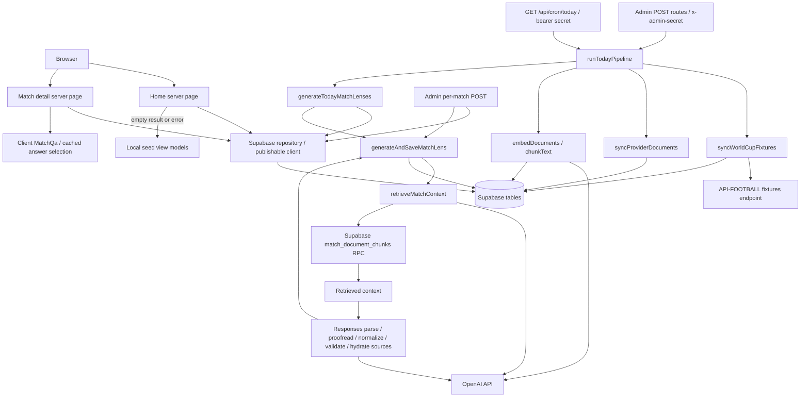

# Verified current architecture

Inspected 2026-11-02. This describes repository code, not an exercised deployment. Historical replay is a product goal, not an implemented mode. Database schema, pgvector extension/indexes, RPC SQL, RLS policies, deployed resources, and actual stored data are unresolved: no SQL/migrations or infrastructure definitions establishing them are tracked.

## Components and flow

Other admin POST routes invoke fixture sync, provider document sync, embedding, or today's generation individually. RPC internals are not present; the diagram asserts the call, not its SQL implementation.

## Public reads and UI

`src/app/page.tsx:Home` awaits `connection()` and calls `src/lib/supabase/repository.ts:getProviderMatchesForLocalDate`. It defaults to the real current day in `America/Los_Angeles`, computes local midnight boundaries, queries API-FOOTBALL matches with joined teams/venue, bulk-loads lenses, and sorts live, upcoming, finished, then unknown statuses. Missing relations are discarded. Empty results and caught errors both select `src/lib/lens.ts:getAllMatchViewModels` over `src/data/seed.ts`; this is not an explicit historical dataset mode.

`src/app/matches/[id]/page.tsx:MatchPage` awaits route params, reads Supabase through `getMatchViewModel`, then reads `qa_answers`. Missing matches use `notFound`; missing lenses render an unavailable message. It does not use the seed fallback. Detail/all-match selects omit score/status columns that the today query reads. `src/lib/types.ts` defines app types; repository row types and casts are handwritten, not generated schema validation.

`AppShell` composes `Sidebar` and `TopNav`; match cards link to details. `MatchQa` is a client component selecting existing answers with state; no question-generation endpoint exists. Date/group badges, sidebar buttons, search, notifications, and settings have no behavior. `StandingsSnapshot` renders literal zeros and generic group copy. `MatchLensCards` renders numerical edge bars and source titles/snippets. Tailwind styles, Radix primitives, and Lucide icons implement presentation. `src/app/layout.tsx` loads Google Geist fonts and retains starter metadata.

## Ingestion and persistence

`src/lib/fixtures/api-football.ts:fetchWorldCupFixtures` fetches `/fixtures` with league/season defaults `1`/`2026`, API key header, and `cache: "no-store"`. `normalizeApiFootballFixture` maps provider fixtures to team, venue, and match records. `syncWorldCupFixtures` deduplicates by application ID and sequentially upserts `teams`, `venues`, and `matches` using the privileged client. Team IDs are name slugs; codes append external IDs. Strengths are all 50. Venue country comes from league country; round becomes `group_name` when it is not a group. Canonical status is always `scheduled`; provider statuses and goals are stored separately. Raw responses and extra-time/penalty breakdowns are not persisted by this writer.

`src/lib/documents/sync-provider-documents.ts:syncProviderDocuments` synthesizes team/venue profiles from provider-linked rows. It reuses the first existing entity/profile document ID or creates a UUID and upserts `documents` with null source URLs. No external article crawler or file-upload ingestion is implemented here.

`src/lib/documents/embed-documents.ts:embedDocuments` reads all documents, chunks each body using `chunkText` (1,200 characters, 180 overlap), embeds per document, deletes old chunks, then inserts replacements into `document_chunks`. Metadata contains title/type/source URL/entity IDs. `src/lib/ai/embeddings.ts` defaults to `text-embedding-3-small`, checks output counts for batches, and orders by response index. No incremental hash/version skip or atomic chunk swap exists.

## Retrieval, generation, and caching

`retrieveMatchContext` embeds a team/group/venue query and calls `match_document_chunks` with threshold 0.15, count 8, team IDs, venue ID, and match ID. It has no historical cutoff argument. Database-side filter semantics and vector dimensions cannot be verified locally.

`generateMatchLens` defaults to `gpt-5-mini`, rejects empty context, and allows two application generation attempts. Each attempt calls Responses `parse` with `MatchLensSchema`, then another Responses call in `proofreadMatchLens`. Copy normalization and a small suspicious-word pattern list follow. `hydrateLensSources` replaces model sources with title-deduplicated retrieved snippets; this attaches retrieval context, not claim-level citation proof. The final transformed object is not re-parsed against the schema. Prompt restrictions are stronger than some programmatic checks (for example edge order/values and allowed slight-edge team names).

`generateAndSaveMatchLens` upserts one `match_lenses` row per match containing JSON, model, and update timestamp. Today's generation skips existing rows unless `refresh=true`; it selects only today's live/upcoming matches and processes sequentially. This is database output caching, without source/prompt/model-version invalidation or historical snapshots. `qa_answers` are read, but no writer is tracked. No explicit Next cache/revalidation policy is configured; `next.config.ts` is empty apart from its exported object.

## Operations and trust boundaries

`src/lib/supabase/server.ts:createServerSupabaseClient` uses public URL/publishable key, without session persistence. `admin.ts:createAdminSupabaseClient` uses `SUPABASE_SECRET_KEY`. Both are server-only; `src/lib/ai/openai.ts` constructs the OpenAI client using `OPENAI_API_KEY`.

All six admin routes require a configured `ADMIN_GENERATION_SECRET` equal to `x-admin-secret`; cron requires `Authorization: Bearer <CRON_SECRET>`. Missing secrets deny access. `vercel.json` declares `0 8 * * *` for `/api/cron/today`; deployment, execution timezone, runtime limits, and scheduler delivery are not verified. `runTodayPipeline` sequentially performs fixtures → provider documents → embeddings → lenses, reports completed steps and failures, and does not roll back earlier writes. No tracked queue, persistent run ledger, concurrency lock, or duration configuration exists.

Environment names: Supabase URL/publishable/secret keys above; OpenAI key plus optional `OPENAI_EMBEDDING_MODEL`/`OPENAI_MATCH_LENS_MODEL`; `API_FOOTBALL_KEY` plus optional `API_FOOTBALL_BASE_URL`, `API_FOOTBALL_WORLD_CUP_LEAGUE_ID`, `API_FOOTBALL_WORLD_CUP_SEASON`; admin/cron secrets above. Values were not inspected. `.gitignore` excludes `.env*` and `.vercel`; no tracked environment template, CI, tests, database bootstrap, or licensing manifest exists. `package.json` provides dev/build/start/lint only. See [audit](audit.md) for validation results and [roadmap](roadmap.md) for proposed changes.
