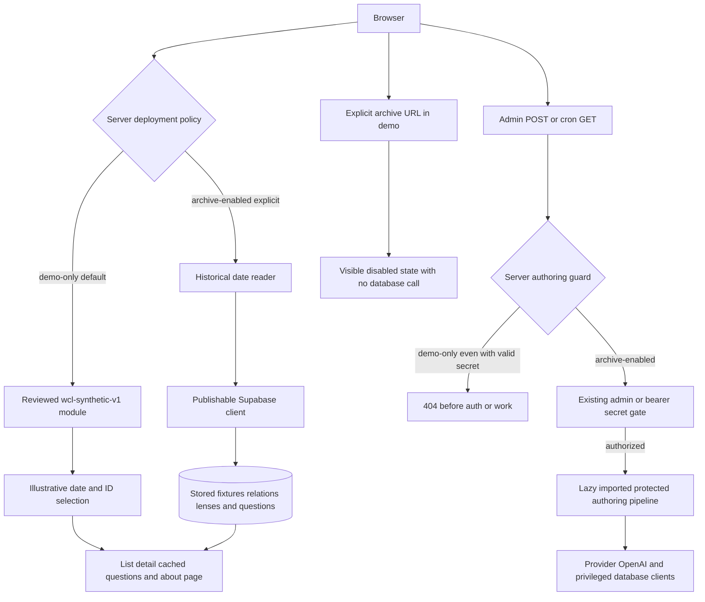
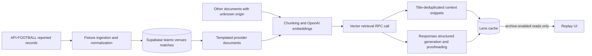

# Verified current architecture

Inspected 2026-11-03. World Cup Lens now has a self-contained public demo and a separately configured historical archive/authoring path. This describes repository code and local/CI checks, not an invented deployment or a reproducible production database. No migrations/RPC SQL/RLS definitions are tracked.

## Deployment and trust boundaries

`src/lib/deployment-mode.ts:deploymentMode` reads the non-public server variable `WCL_DEPLOYMENT_MODE`. Only exact `archive-enabled` opts in to the historical/backend boundary. Missing, invalid, or `demo-only` values select `demo-only`. Lower-level replay helpers also default closed. No URL, client control, credential presence, or fallback can enable archive functionality.

The public demo is decoupled from the database so service availability, paid credentials, and uncleared historical data are not prerequisites for demonstrating UI/engineering work. Archive mode retains its meaning; it is not an alias for fictional content. The flag must be set consistently at build and runtime/deployment. `/about` uses request-time `connection()` so its explanation follows runtime policy rather than a stale static mode snapshot.

## Replay and public reads

Both public pages await Next.js 16 promise-based `searchParams`. `parseReplaySelection` validates mode plus strict `YYYY-MM-DD` within June 11–July 19, 2026. In demo-only mode missing mode/date selects illustrative June 11. Explicit archive requests produce “Archive disabled in public demo”; the page contains no archive selector/link and does not substitute examples for an explicitly requested archive. In archive-enabled mode missing mode/date retains archive July 11. Duplicate/invalid input is a separate validation state.

`src/lib/replay-access.ts` passes actual server policy to shared `loadReplay`/`loadReplayAnswers` and imports the Supabase repository only inside an allowed archive reader. Demo reads use the reviewed local `src/data/seed.ts` module, not a database or an AI API. `buildIllustrativeViewModel` handles missing relations and rejects incompatible cached text; missing commentary preserves available fixture details. `loadReplay` validates calendar timestamps, filters a half-open Los Angeles calendar day, sorts by kickoff/ID, and selects the first fixture as featured. It has distinct ready/empty/error results. It never silently falls back between datasets.

`src/app/page.tsx` renders the date form, notice, featured matchup and cards. `src/app/matches/[id]/page.tsx` resolves the ID inside the same dataset/day result; missing IDs show a useful selection-specific message (not a dedicated 404). `replayHref` preserves mode/date in card/back links. Empty days, invalid selections, missing matches/cache, and archive query errors have different messages. `src/app/loading.tsx` supplies loading UI. The public demo's date exploration intentionally has examples on two dates rather than a complete tournament calendar.

`getProviderMatchesForDate` uses explicit local-midnight UTC boundaries and provider-only matches with joined team/venue rows, followed by a batched Lens lookup. `dateBounds` computes each Los Angeles midnight independently, including DST; a selected date is not a UTC instant or knowledge cutoff. Missing relations fail rather than silently omitting fixtures. Missing/invalid/unreadable lenses preserve fixtures with cache-state notices. Cached questions have a separate unavailable state. `getProviderMatchesForLocalDate` remains for legacy today-based authoring and retains live-first ordering; public replay never uses its real-clock default.

## Reviewed demo and presentation

The newly authored `wcl-synthetic-v1` contains four fictional teams with alphabetic initials, two fictional locations, three scenarios, stored sample commentary and preset questions. No real team profiles, national flags, provider records, external quotations, results, logo assets, or numerical strengths are inputs. Strength fields are null; `TeamStrengths` permits unknown values without assigning arbitrary numbers. All fixtures and copy are explicit fiction; “No real result” replaces result-like display in illustrative mode. The replaced legacy examples remain in Git history, not in current demo selection.

`DEMO_PUBLICATION` records a scoped review/version and evidence file, not a heuristic licensing engine. [Publication review](demo-publication-review.md) approves only this new original material and original icon. Existing UNKNOWN provider/editorial/legacy rights remain unknown. Starter SVGs/favicon were removed; system fonts and existing licensed software/icons are used, with named-package notices at `/third-party-notices.txt`.

`MatchLensCards` preserves qualitative cards but withholds all numerical team comparisons. `PublicMatchLens` excludes unsupported edges; ignored malformed/missing numerical fields cannot erase otherwise compatible text. Confidence/volatility/edge values are labeled uncalibrated stored opinions, and null edge means no edge stated. Lens/Q&A context is not claim-level citation proof. `MatchQa` is a client component switching between cached answers; it does not send a question to a service. `/about` explains both branches and has functional navigation/license links. All visual layout remains Tailwind/Radix/Lucide-based.

`analysisProvenance` separates recorded event reference from optional cache write time. Source publication/capture, model generation and historical cutoff remain unknown for archive rows, and its dataset version remains null. Synthetic mode identifies version `wcl-synthetic-v1` and labels model-generation/cutoff concepts not applicable to authored fiction. No historical timestamp is fabricated and no cached archive prose is rewritten. See [provenance/time contract](data-provenance.md).

## Protected historical authoring path

All six admin POST routes under `src/app/api/admin/` and `GET /api/cron/today` check the deployment guard first. Demo-only responses are 404 even with matching secrets; implicit cron HEAD also receives the guarded result. Business functions are dynamically imported after the guard and existing auth. Archive-enabled operation still requires `x-admin-secret` / `ADMIN_GENERATION_SECRET`, or cron bearer `CRON_SECRET`. No route test authorizes real work.

`runTodayPipeline` awaits fixtures → provider document synthesis → full-corpus embedding → today's live/upcoming Lens generation. Fixture ingestion uses provider IDs/status/goals but assigns placeholder strengths, derived codes/flags, and league country to venues. Document sync synthesizes profiles with null source URLs. Embedding deletes/replaces chunks per document without atomic versioning. Retrieval calls `match_document_chunks` with entity filters but no historical cutoff; RPC SQL/indexes are not tracked. Generation parses Zod structured output, proofreads, normalizes, and attaches snippets before saving one mutable JSON/model/update row per match. Source IDs/URLs and immutable lineage are lost; snippets are not mapped to claims. Cache presence, not content versions, controls skip behavior. No authoring operation was executed by this milestone.

`server.ts` uses publishable credentials; `admin.ts` and OpenAI factories remain server-only. Actual backend policies/dimensions are unverified. Private/archive configuration and [historical source rights](data-rights.md) are separate gates; neither demo publication nor API subscription grants historical export permission. `vercel.json` schedules no cron.

## Verification and delivery

CI uses pinned actions, read-only token permissions, Node 22, `npm ci`, unit tests, lint, typecheck (`next typegen` first), build, archive-enabled mock HTTP checks, production-server and unset/invalid development-server demo isolation checks, and committed/generated whitespace validation. No real service credentials are supplied. The demo harness starts with empty service settings, asserts the fetch-denial preloader is active, checks browsing plus local guarded methods with matching dummy secrets, and asserts zero service fetches. These checks are not browser interactivity, full egress enforcement, production policy, or historical accuracy verification.

The existing `jt254/world-cup-lens` Vercel project was inspected through its authorized dashboard and first deployed on 2026-11-03. It tracks `main`, uses Next.js at the repository root, and serves [the public demo](https://world-cup-lens-one.vercel.app). Production has only the non-secret demo-only policy configuration; no service keys were supplied. Node 22 matches the repository engine constraint. No cron jobs were listed, and project cron execution was explicitly disabled. No new project, paid plan or data migration was created. See [deployment evidence](deployment.md) for revision-specific status, browser QA and evidence limits. The public HTTP check is explicit and is not part of offline CI.
