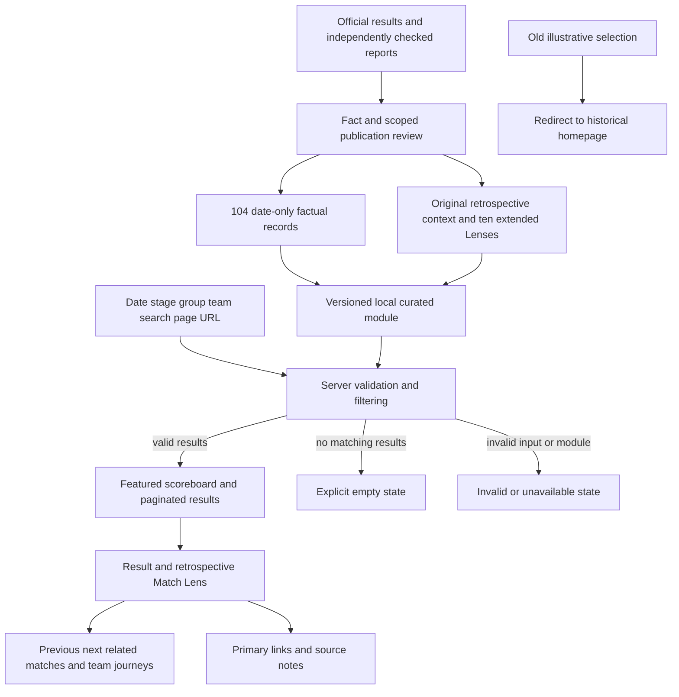
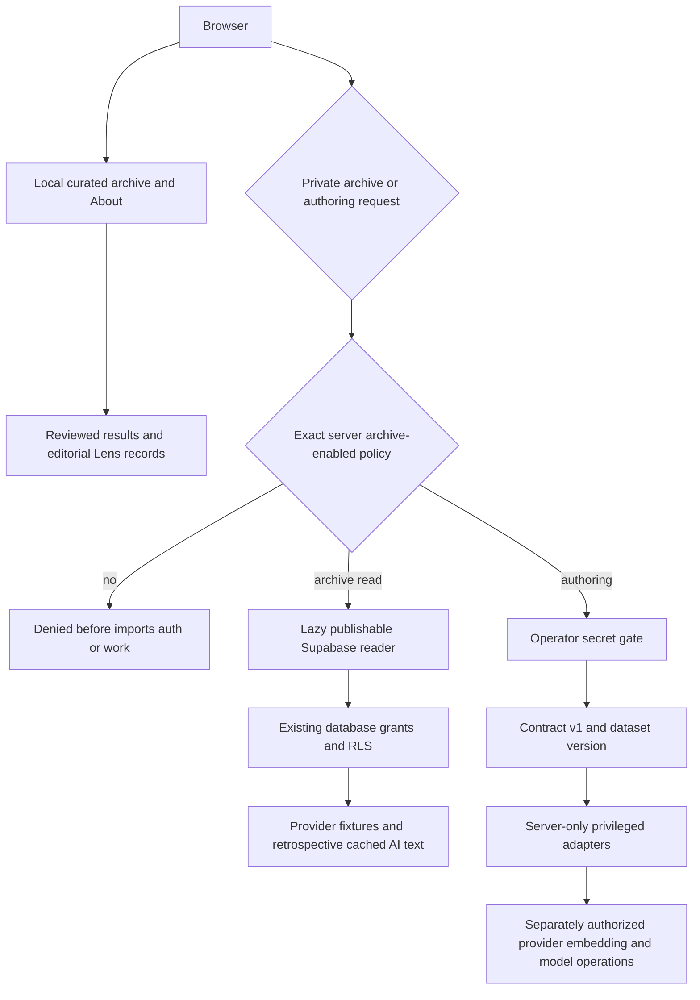

# Architecture

World Cup Lens separates a self-contained public tournament archive from a private Supabase/RAG system. Public Match Lenses are original retrospective editorial records; they are not presented as OpenAI output. The database migrations reconstruct a disposable contract and do not establish production schema parity. Deployment evidence belongs in [deployment](deployment.md); source and publication boundaries belong in [the historical review](curated-history-review.md).

## Public archive

`src/data/curated-records.json` contains 104 date-only results. `src/data/curated-lenses.json` supplies ten deeper retrospectives; `src/data/curated-history.ts` combines those inputs with concise tournament context and publication/version metadata. `src/lib/curated-contract.ts` defines a separate contract from timestamp-based private provider fixtures.

`src/lib/curated-history.ts` validates record identities, stage totals, group coverage, results, source metadata and knockout progression. It distinguishes malformed data from valid empty selections. No result is substituted from a fictional or private collection when validation fails. A primary factual source must use an approved official FIFA hostname; linked evidence is not treated as a licence or automatic factual guarantee.

The default public day is July 11, featuring Norway–England. Full-tournament browsing uses `date=all`; date, stage/group, team and text filters are URL-driven. The list is ordered by event day and tournament match number, a stable convention that does not invent kickoff order. The featured match is excluded from secondary cards. Pagination avoids rendering the entire tournament on the landing page.

Each curated detail resolves its stable ID independently of the list filter, preserving a usable return link. `curatedHref` carries the selected state. `curatedNavigation` chooses previous/next within the matching selection when possible, otherwise the whole tournament; related links follow the participating teams. `groupRecord` derives a team's played/won/drawn/lost/points/goals through the selected tournament match number. It is not an official ranked group table or a tiebreaker implementation.

`finalScore` includes regulation and any extra-time goals. `penaltyShootout` is separate; `advancingTeam` is checked against the deciding result; in the final and third-place record it denotes the winner, and stage-aware copy does not imply another round. Unknown extra-time information stays null. Event dates remain `YYYY-MM-DD`, with `day` precision and source-local-event-day basis. No midnight kickoff, regulation score, lineup, historical cutoff or generated-at timestamp is manufactured.

## Match Lens presentation

`CuratedHome` and `CuratedMatchDetail` preserve the forest-green editorial design: large scoreboards, restrained pitch geometry, date navigation and responsive fixture cards. The detail uses a consistent retrospective Lens structure: overview, significance, original interpretation, optional source-linked developments and explicit evidence limits. Optional sections avoid filling gaps with invented tactical prose. All records have concise context; ten have extended match-specific reporting.

The public interface has one responsive header, a skip link, a main landmark and a concise non-affiliation footer. `TopNav` is a small client component for mobile disclosure, Escape handling and focus return. Selection and match rendering remain server responsibilities. Public browsing does not request a database, embedding, model or provider service. Old illustrative selections redirect to `/?mode=curated`; the fictional lab is no longer a public product. Deterministic synthetic fixtures and private cached Q&A remain available to their existing test/private paths.

Primary links are visible alongside source notes. Detailed evidence/version/unknown-field disclosures are progressively revealed rather than repeated across every card. Source excerpts are not copied into the public dataset, and original editorial text is never labeled generated analysis. The [design document](design.md) records visual decisions and actual browser evidence.

## Deployment and service boundaries

`src/lib/deployment-mode.ts:deploymentMode` reads the server-only `WCL_DEPLOYMENT_MODE`. Only exact `archive-enabled` opens the private boundary. Missing, invalid and `demo-only` values select demo-only. Neither URL values nor credential presence can override that policy.

`replay-access.ts` lazily imports the Supabase repository only after the archive policy check. Private provider reads use half-open America/Los_Angeles calendar-day bounds, computed independently at each midnight. Curated event days do not pass through timezone conversion. Missing joined relations fail the private archive query rather than silently dropping fixtures; invalid/missing cache text leaves the available fixture visible.

All six admin POST handlers and cron GET/implicit HEAD check the deployment guard before authentication and work. Private mode additionally requires the existing admin or cron secret. `vercel.json` has no schedule. Removing the public lab does not broaden database permissions or turn on any backend service. `/about` uses request-time `connection()` so its policy explanation reflects runtime configuration.

## Private authoring and database contracts

```mermaid
flowchart LR
  Provider[Private provider records rights UNKNOWN] --> Ingest[Privileged normalization and separate upserts]
  Ingest --> Documents[Document heads and source metadata]
  Authorized[Original synthetic or separately authorized sources] --> Documents
  Documents --> Pending[Changed input model or chunker versions]
  Pending --> Revision[Atomic document version and embedding chunks]
  Revision --> Retrieve[Entity version and optional cutoff eligibility]
  Retrieve --> Identity[Canonical input source prompt model identity]
  Identity --> Cache{Valid cache}
  Cache -->|hit| Stored[Validated stored output]
  Cache -->|miss with evidence| Generate[Structured generation and proofreading]
  Generate --> Validate[Hydration normalization and final validation]
  Validate --> Commit[Atomic immutable run and cache winner]
  Commit --> Adapter[Private retrospective legacy adapter]
  Adapter --> PrivateUI[Private archive subject to policy and RLS]
```

`runTodayPipeline` retains legacy live-operation selection, but requires contract v1 and `WCL_AUTHORING_DATASET_VERSION`. Fixture upserts are separate transactions. Normalization maps supported statuses explicitly, leaves missing venue country Unknown and unknown strengths null. Provider-derived documents have stable identities, preserve unchanged capture clocks and do not invent publication times. Embedding selects at most 50 stale heads and atomically appends revisions/chunks; it never deletes all history on a scheduled run.

`rag/engine.ts:runVersionedLens` injects embedding, retrieval, model, cache and persistence dependencies. Entity and optional availability filters constrain semantic ranking. As-of experiments additionally require an exact input-fingerprint attestation; the HTTP authoring adapter remains retrospective. Final schema/team validation runs after all transformations, but does not guarantee factual grounding. Immutable source/run metadata is separate from the limited display excerpts. A failed persistence attempt retains an in-memory private retry envelope; durable recovery and corpus-wide serializability remain deferred.

`server.ts` is the publishable reader; `admin.ts`, `authoring.ts` and service adapters are server-only. Reconstructed SQL defaults provider/source/history rows private. Anonymous reads allow only explicitly synthetic-public presentation rows, so the legacy provider-filtered reader cannot populate that database without a separately reviewed operator-read/publication design. No production policies or function bodies are inferred from TypeScript or direct SQL tests. See [database contract](database-contract.md), [security](backend-security.md), [retrieval](retrieval-design.md) and [RAG/cache failures](rag-pipeline.md).

## Verification boundaries

Unit tests check curated contracts, filters/navigation, display labels and mocked generation behavior. Disposable PostgreSQL tests exercise actual constraints, invoker RPCs, vector ranking, grants/RLS, cutoffs, cache history and failure transactions. Archive HTTP tests mock the gateway; demo HTTP tests deny service fetches and exercise guarded routes with dummy settings. Browser checks establish specific layout/navigation/focus observations, not accessibility certification.

GitHub Actions uses Node 22, locked installs, deterministic tests, a disposable PostgreSQL/pgvector job, HTTP isolation checks, lint/typecheck/build and repository checks. Production smoke checks and browser captures are explicit, separate verification. Passing tests do not establish real-model grounding quality, authenticated historical forecasts, live Supabase gateway/Auth coverage, production schema parity or legal clearance. Revision-specific results must be recorded after execution, not assumed from this design.

## Worked public example

1. The local factual module records `norway-england-2026-07-11`, match 99, quarter-final, Miami Stadium, 1–2 after extra time, with evidence metadata and explicit unknown clocks.
2. The public default selects July 11; `loadCuratedHistory` validates the full dataset and chooses this fixture as featured without constructing a service client.
3. `curatedHref` creates the detail URL carrying the current date/filter state. The secondary list excludes the featured ID.
4. `CuratedMatchDetail` reads the original extended Lens, reports the sourced scoring sequence and limits, and links related team matches and the primary evidence.
5. Returning to the list restores its selection. No cached private AI output, fictional record or model call is involved.

The [technical walkthrough](technical-walkthrough.md) separately traces the original Maple/Harbor synthetic input through actual backend code, SQL and tests. That test corpus remains independent of the public historical archive.
