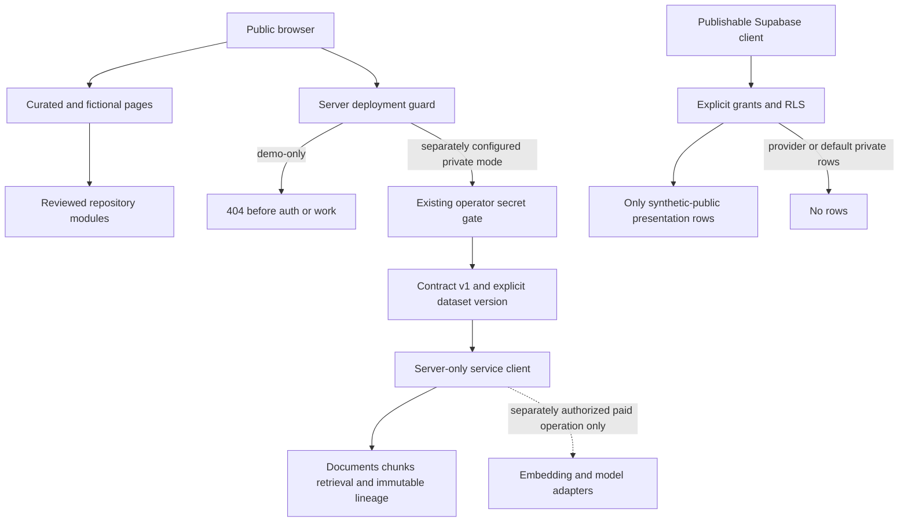

# Backend security boundaries

The public demo stays `demo-only`: local curated history and original fiction only. No database credentials are required, no backend route is enabled, and no scheduled cron exists. The tracked SQL defines a disposable/private contract; it has not been applied to production.

## Reconstructed access policy

All twelve tables enable RLS. Anonymous and authenticated roles get SELECT on five presentation tables only; policies require synthetic origin and explicit synthetic publication. Match reads also require readable opponents/venue; Lens/Q&A reads require a readable match. Documents, versions, chunks, generation runs/bridges, cache identities and input attestations have **no public table grants or policies**. API provider factual fields do not become publishable by being in a database.

`service_role` receives only the table operations used for authoring: mutable base tables, append/read on immutable tables, insert/read cache pointers. Immutable UPDATE/DELETE triggers also reject accidental owner updates. A real Supabase service key can bypass RLS, but still requires SQL privileges; it must remain server-only and is a trusted operator boundary. Superusers/table owners can deliberately disable protections: this is application history integrity, not cryptographic tamper-proof storage.

Every application RPC is explicitly revoked from PUBLIC/anon/authenticated and granted only to service_role. All functions use **SECURITY INVOKER**, a fixed empty search path and qualified relations/operators. Extension schema usage is privileged. Public schema CREATE is revoked. No SECURITY DEFINER privilege escalation is used. New functions/tables default to no anonymous access.

## Compatibility is deliberately restrictive

The existing private archive reader in `src/lib/supabase/repository.ts` uses publishable access and filters API-FOOTBALL records. Under this reconstruction it will see **no provider rows**, even in archive-enabled mode. This is an intentional default-deny publication boundary, not a claim that the live project's policies match. Private authoring now uses `supabase/authoring.ts` and `get_authoring_input`, rather than depending on public RLS. Do not relabel synthetic rows as API-FOOTBALL to make archive screens populated. A future separately reviewed authenticated/operator read design is needed for a useful private provider archive on this schema; public demo is unchanged.

Authoring preflight requires backend contract 1 and `WCL_AUTHORING_DATASET_VERSION` before ingestion/embedding/generation. Existing production schema has not been upgraded and its authoring adapters will fail closed until an explicitly reviewed migration is applied elsewhere. Operational migration and paid authoring require separate authorization.

## Time and input trust

Source availability requires publication **and** capture time plus nonempty identity/evidence. Both clocks must be at/before cutoff. Unknown is excluded, not assigned kickoff/cache time. Editing document content, scope or provenance automatically clears the prior availability review; re-attestation requires a separate deliberate update after reviewing the exact new material. As-of generation also requires an immutable attestation matching the entire input fingerprint; changing a team, venue or fixture invalidates it. The prompt receives an allowlist without scores, current status, mutable summaries or strengths.

These checks establish the recorded operator assertions and input boundary. They do not authenticate a publisher's clock, attest model training data, guarantee that prose obeys evidence, or validate real historical forecasts. Synthetic attestations in tests are explicitly fictional. Production legacy output is never backfilled or relabeled as a forecast.

## Errors and operations

Admin/pipeline responses and logs no longer expose upstream exception bodies, SQL error text or source snippets. Failed runs persist only bounded error codes. `PersistenceFailure` holds a private in-memory checkpoint for retry and must never be serialized to logs or public responses. Provider response IDs/model labels, when available, stay in private run submission metadata. No environment files are read by the database runner; PG/service environment variables are removed from child processes. It cannot accept a production destination.

`npm run check:credentials` rejects reviewable environment files and common credential/private-key patterns, reporting paths only. It is a regression guard, not proof that every possible secret is absent. Git diff/staging inspection is still required. Neither SQL nor TypeScript expands licensing rights.

## Verified and unresolved

Real PostgreSQL tests exercise grants and RLS using NOBYPASSRLS service_role, anon and authenticated; no production policies were exercised. Hosted PostgreSQL 17 runs separately from native PostgreSQL 14. Supabase Auth, PostgREST integration/relationship introspection and live service-role behavior require additional isolated-stack coverage. Existing shared operator secrets are not user accounts, per-user audit identities or a distributed job authorization system. Long-running private HTTP authoring still needs bounded background jobs before operational use.

Primary references: [PostgreSQL row security](https://www.postgresql.org/docs/17/ddl-rowsecurity.html), [Supabase function security](https://supabase.com/docs/guides/database/functions). The migrations and executed tests, rather than those documents alone, establish this repository's behavior.
