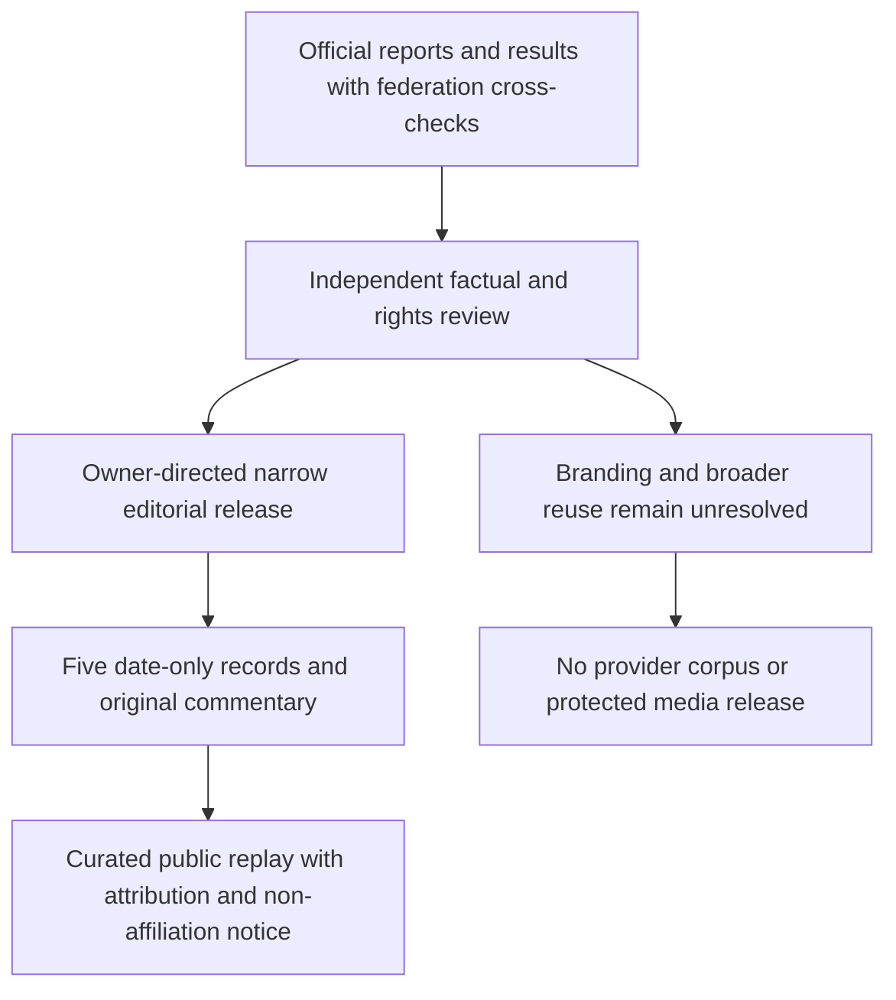

# Curated historical selection: publication review

Review ID: `wcl-curated-2026-v1`. Evidence access/review date: **2026-11-03**. Implementation baseline: `5fc076d`. Decision: **OWNER_DIRECTED_EDITORIAL_RELEASE of exactly five independently selected records and original retrospective commentary**, in the public source repository and noncommercial portfolio demonstration. The owner explicitly superseded the previous internal HOLD. That HOLD was a conservative release decision, not a legal determination that factual reporting is prohibited.

This is a narrow editorial decision, not blanket FIFA permission, an open-data licence, definitive trademark clearance, or permission to redistribute a provider database. Remaining questions are recorded below; they have not been transformed into legal certainty.

## Evidence reviewed

The independently checked records are implemented in `src/data/curated-history.ts`. Official reports/results support the following facts; federation reports independently corroborate the outcomes. No API-FOOTBALL payload or Supabase export is an input.

| Match | Event day | Stage | Venue | Final score | Extra time |
| --- | --- | --- | --- | --- | --- |
| Mexico–South Africa | 2026-06-11 | Group A | Mexico City Stadium | 2–0 | No |
| USA–Paraguay | 2026-06-12 | Group D | Los Angeles Stadium | 4–1 | No |
| Norway–England | 2026-07-11 | Quarter-final | Miami Stadium | 1–2 | Yes |
| Argentina–Switzerland | 2026-07-11 | Quarter-final | Kansas City Stadium | 3–1 | Yes |
| Spain–Argentina | 2026-07-19 | Final | New York New Jersey Stadium | 1–0 | Yes |

| Requested candidate | Official evidence / location | Independent primary-source cross-check |
| --- | --- | --- |
| Mexico–South Africa, June 11 | [FIFA full-time report, p1](https://fdp.fifa.org/assetspublic/ce281/r12452/pdf/FullTimeMatchReport-English.pdf): date, result, group and tournament venue name | [CAF report](https://www.cafonline.com/fifa-world-cup/news/south-africa-left-with-work-to-do-after-opening-defeat-to-mexico/): dated account of completed group fixture |
| USA–Paraguay, June 12 | [FIFA Training Centre post-match report, p1](https://www.fifatrainingcentre.com/media/native/tournaments/fifa-world-cup/2026/PMSR-M04-USA-V-PAR.pdf): date, result, group, venue | [Concacaf report](https://www.concacaf.com/news/balogun-brace-steers-usa-to-victory-against-paraguay): completed Group D match and venue |
| Norway–England, July 11 | [FIFA schedule/results](https://www.fifa.com/en/tournaments/mens/worldcup/canadamexicousa2026/articles/match-schedule-fixtures-results-teams-stadiums): July 11 entry, venue and extra-time marker | [England Football match centre](https://www.englandfootball.com/england/mens-senior-team/fixtures-results/2025-26/world-cup/norway-england-fifa-world-cup-quarter-final-saturday-11-july-2026-match-centre): date, quarter-final, venue and after-extra-time status |
| Argentina–Switzerland, July 11 | [FIFA match report](https://www.fifa.com/en/tournaments/mens/worldcup/canadamexicousa2026/articles/argentina-switzerland-match-report-highlights): explicit local match day, quarter-final, venue and extra time | [UEFA results](https://www.uefa.com/european-qualifiers/news/02a6-20c3aa0fafe2-4a6b4459a3fc-1000--2026-world-cup-all-the-european-sides/): result/stage/extra time; date convention differs, see below |
| Spain–Argentina, July 19 | [FIFA final report](https://www.fifa.com/en/tournaments/mens/worldcup/canadamexicousa2026/articles/spain-argentina-final-report-highlights): date, final, tournament venue and extra time | UEFA results above: final result, day and extra-time outcome |

Access method: readable official PDFs and federation pages, plus publicly indexed FIFA article/results text. Several direct FIFA article opens yielded no readable body; the index supplied the relevant passages. This is weaker than retaining a complete source snapshot. No screenshots, articles, PDFs, statistics tables, photographs or raw third-party exports were copied into Git. Match events, players, formations and tactical statistics were outside the proposed scope.

Date caveat: FIFA's Argentina report is published the day after its explicitly stated local match day; UEFA lists a different calendar day. Do not replace event day with article publication day, or invent a timezone explanation for a source that does not state one. The module separately stores event day, source publication day where established, and evidence access/review days. Group fixtures are recorded as completed without extra time; that classification also uses the competition's group-stage convention rather than an absent `extraTime` JSON field. `CuratedMatch` is a separate date-only contract; no kickoff instant, regulation score, source capture instant or historical knowledge cutoff is inferred.

## Rights evidence and decision

- [FIFA Terms of Service](https://legal.fifa.com/terms-of-service), §§5.3, 6.2, 6.4 and 7: §6.4 provides a conditional, non-transferable noncommercial website-display licence, requiring attribution, source links where possible and no implied endorsement. It does not expressly settle this repository's public source-distribution scope; the owner proceeds with the narrow factual/editorial selection rather than claiming a blanket licence. General restrictions must be read alongside that express permission, not presented as a blanket prohibition on credited editorial reporting.
- [Official legal/branding FAQ](https://inside.fifa.com/organisation/contact-fifa/legal-branding-and-rights), C–E: supports credited, purely editorial noncommercial use of FIFA.com text/statistics; excludes protected images, logos and material originating elsewhere. This supports a possible website use, not a provider export or automatic approval of this entire release.
- [Official 2026 IP guidelines](https://digitalhub.fifa.com/m/3567360896991b48/original/FIFA-World-Cup-26-IP-Guidelines.pdf), June 2024 v2, pp2, 7, 14, 18, 21–22: accept descriptive editorial apps/schedule uses subject to conditions; identify “World Cup” as a wordmark and restrict official IP in domains. The existing name/domain retains branding uncertainty. The owner directs this unofficial, visually independent editorial release with a clear non-affiliation notice; no-logo presentation alone is not definitive clearance. The guidance is not case-specific clearance and excludes third-party rights.
- [GitHub Terms](https://docs.github.com/en/site-policy/github-terms/github-terms-of-service), D.3–D.5: public repositories involve hosting/copying and user forking permissions; uploaders must have compatible rights. Whether these independently selected factual fields need or already have sufficient rights for that use is unresolved here. Neither an attribution notice nor absence of a repository licence answers that question by itself.

No advertising/payment functionality was identified in the inspected public UI. That supports, but does not establish, the purely editorial/noncommercial classification of a portfolio intended to demonstrate professional work. No monetisation restriction, legal entitlement, rights-holder approval or ownership exemption was invented. FIFA permission is not inferred for federation cross-check material; those sources are references only.

| Proposed field/category | Classification | Proposed narrow website use | Public GitHub inclusion / release decision |
| --- | --- | --- | --- |
| Team names, event day, stage, final score, extra-time status, venue name | Independently selected factual observations from cited sources | Conditional editorial support; fulfil attribution/linkback/noncommercial/no-endorsement requirements | OWNER_DIRECTED_EDITORIAL_RELEASE for these five records only; no downstream blanket licence |
| Source URL, access date, source identity | Original evidence metadata and references | Suitable for source acknowledgement | APPROVED for this review document; not an approval of linked content |
| Newly authored retrospective commentary | Original expression grounded only in approved facts | Original retrospective expression, labeled authored and separate from Match Lens pipeline output, not predictive | OWNER_DIRECTED_EDITORIAL_RELEASE; original copy in this module only |
| Logos, photos, official typefaces, crests, badges, video, article excerpts | Protected/third-party expression | Excluded from proposed selection | NOT_APPROVED; not downloaded into repository |
| API-FOOTBALL/Supabase records and cached prose | Separate legacy/provider corpus | Existing unresolved restrictions apply | NOT_APPROVED; no export or rights upgrade |
| Product name/domain and portfolio context | Branding/use context | Needs scoped assessment | UNRESOLVED clearance; owner-directed unofficial editorial use, no endorsement claim |

## Release scope and remaining uncertainty

The explicit owner decision authorizes the narrow use of five selected factual observations, original commentary, source URLs and review metadata. It does not establish unrestricted commercial reuse, an entire tournament database licence, contractual rights for API-FOOTBALL exports, or rights to the private cached AI corpus. Public GitHub inclusion is a scoped project release decision; it is not a guarantee about all downstream forks or uses. No new data licence is granted.

The portfolio's noncommercial/editorial classification, source-distribution scope and existing product/domain branding are not case-specifically cleared by FIFA. Keep these uncertainties visible. Reassess before monetisation, sponsorship, expanded/bulk datasets or branding changes; obtain a scoped independent legal assessment or rights-holder clarification where needed. No enquiry was sent on the owner's behalf.

Official logos, article wording, PDFs, photographs, graphics, crests, fonts and video are excluded. Sources are linked, not copied. No third-party article excerpts or media are bundled. Plain team and venue names are descriptive factual labels. The shared footer states that the project is unofficial and not affiliated with, sponsored by or endorsed by FIFA or any national association.

## Evidence and verification limits

Readable official PDFs were rechecked directly. FIFA article/results evidence was rechecked in publicly indexed text where direct article bodies remained unavailable. This is weaker than a retained full source snapshot; no source capture timestamp or content hash is claimed. England Football, UEFA, CAF and Concacaf supplied independent primary cross-checks. Source access is not a rights grant.

Deterministic record/validation tests and rendered HTTP checks verify the release's implementation against these reviewed tuples. They do not independently authenticate publisher content, promise permanent source availability or certify legal clearance. Review/CI/deployment evidence for the delivered revision belongs in [deployment.md](deployment.md) and the delivery handoff.
