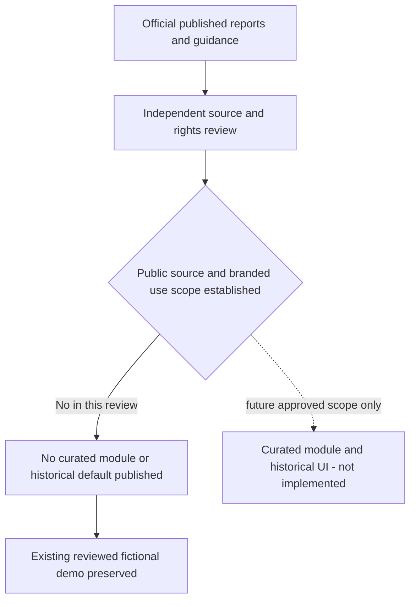

# Curated historical selection: publication review

Review ID: `fifa-candidates-2026-11-03-v1`. Access date: **2026-11-03**. Baseline: `26310e9`. Decision: **HOLD for the proposed public GitHub module and existing branded portfolio deployment**. This is a release decision under the task's uncertainty rule, not a finding that factual reporting is unlawful or that an unrestricted open-data licence is required for every editorial use.

## Evidence reviewed

The candidate labels/dates below come from the task. Official reports/results support the requested date, score, stage, venue and extra-time checks. No provider/database records were used. To avoid publishing the proposed dataset before its gate passes, this public document records source references and verification scope rather than embedding the result tuples or a runnable historical module. Detailed factual notes were delivered locally outside the Git checkout.

| Requested candidate | Official evidence / location | Independent primary-source cross-check |
| --- | --- | --- |
| Mexico–South Africa, June 11 | [FIFA full-time report, p1](https://fdp.fifa.org/assetspublic/ce281/r12452/pdf/FullTimeMatchReport-English.pdf): date, result, group and tournament venue name | [CAF report](https://www.cafonline.com/fifa-world-cup/news/south-africa-left-with-work-to-do-after-opening-defeat-to-mexico/): dated account of completed group fixture |
| USA–Paraguay, June 12 | [FIFA Training Centre post-match report, p1](https://www.fifatrainingcentre.com/media/native/tournaments/fifa-world-cup/2026/PMSR-M04-USA-V-PAR.pdf): date, result, group, venue | [Concacaf report](https://www.concacaf.com/news/balogun-brace-steers-usa-to-victory-against-paraguay): completed Group D match and venue |
| Norway–England, July 11 | [FIFA schedule/results](https://www.fifa.com/en/tournaments/mens/worldcup/canadamexicousa2026/articles/match-schedule-fixtures-results-teams-stadiums): July 11 entry, venue and extra-time marker | [England Football match centre](https://www.englandfootball.com/england/mens-senior-team/fixtures-results/2025-26/world-cup/norway-england-fifa-world-cup-quarter-final-saturday-11-july-2026-match-centre): date, quarter-final, venue and after-extra-time status |
| Argentina–Switzerland, July 11 | [FIFA match report](https://www.fifa.com/en/tournaments/mens/worldcup/canadamexicousa2026/articles/argentina-switzerland-match-report-highlights): explicit local match day, quarter-final, venue and extra time | [UEFA results](https://www.uefa.com/european-qualifiers/news/02a6-20c3aa0fafe2-4a6b4459a3fc-1000--2026-world-cup-all-the-european-sides/): result/stage/extra time; date convention differs, see below |
| Spain–Argentina, July 19 | [FIFA final report](https://www.fifa.com/en/tournaments/mens/worldcup/canadamexicousa2026/articles/spain-argentina-final-report-highlights): date, final, tournament venue and extra time | UEFA results above: final result, day and extra-time outcome |

Access method: readable official PDFs and federation pages, plus publicly indexed FIFA article/results text. Several direct FIFA article opens yielded no readable body; the index supplied the relevant passages. This is weaker than retaining a complete source snapshot. No screenshots, articles, PDFs, statistics tables, photographs or raw third-party exports were copied into Git. Match events, players, formations and tactical statistics were outside the proposed scope.

Date caveat: FIFA's Argentina report is published the day after its explicitly stated local match day; UEFA lists a different calendar day. Do not replace event day with article publication day, or invent a timezone explanation for a source that does not state one. A future module must separately store verified event time/day and source publication/access metadata. Group fixtures are recorded as completed without extra time; that classification also uses the competition's group-stage convention rather than an absent `extraTime` JSON field. No machine-readable provenance contract or result module was implemented.

## Rights evidence and decision

- [FIFA Terms of Service](https://legal.fifa.com/terms-of-service), §§5.3, 6.2, 6.4 and 7: §6.4 provides a conditional, non-transferable noncommercial website-display licence, requiring attribution, source links where possible and no implied endorsement. It does not expressly settle this repository's public source-distribution scope. General restrictions must be read alongside that express permission, not presented as a blanket prohibition on credited editorial reporting.
- [Official legal/branding FAQ](https://inside.fifa.com/organisation/contact-fifa/legal-branding-and-rights), C–E: supports credited, purely editorial noncommercial use of FIFA.com text/statistics; excludes protected images, logos and material originating elsewhere. This supports a possible website use, not a provider export or automatic approval of this entire release.
- [Official 2026 IP guidelines](https://digitalhub.fifa.com/m/3567360896991b48/original/FIFA-World-Cup-26-IP-Guidelines.pdf), June 2024 v2, pp2, 7, 14, 18, 21–22: accept descriptive editorial apps/schedule uses subject to conditions; identify “World Cup” as a wordmark and restrict official IP in domains. The existing name/domain therefore needs an assessed decision. No-logo presentation alone does not settle it. The guidance is not case-specific clearance and excludes third-party rights.
- [GitHub Terms](https://docs.github.com/en/site-policy/github-terms/github-terms-of-service), D.3–D.5: public repositories involve hosting/copying and user forking permissions; uploaders must have compatible rights. Whether these independently selected factual fields need or already have sufficient rights for that use is unresolved here. Neither an attribution notice nor absence of a repository licence answers that question by itself.

No advertising/payment functionality was identified in the inspected public UI. That supports, but does not establish, the purely editorial/noncommercial classification of a portfolio intended to demonstrate professional work. No monetisation restriction, legal entitlement, rights-holder approval or ownership exemption was invented. FIFA permission is not inferred for federation cross-check material; those sources are references only.

| Proposed field/category | Classification | Proposed narrow website use | Public GitHub inclusion / release decision |
| --- | --- | --- | --- |
| Team names, event day, stage, final score, extra-time status, venue name | Independently selected factual observations from cited sources | Conditional editorial support; fulfil attribution/linkback/noncommercial/no-endorsement requirements | UNKNOWN scope; HOLD for this module |
| Source URL, access date, source identity | Original evidence metadata and references | Suitable for source acknowledgement | APPROVED for this review document; not an approval of linked content |
| Newly authored retrospective commentary | Original expression grounded only in approved facts | Eligible once factual source/use gate passes; label authored, not generated or predictive | DEFERRED; no new historical commentary shipped |
| Logos, photos, official typefaces, crests, badges, video, article excerpts | Protected/third-party expression | Excluded from proposed selection | NOT_APPROVED; not downloaded into repository |
| API-FOOTBALL/Supabase records and cached prose | Separate legacy/provider corpus | Existing unresolved restrictions apply | NOT_APPROVED; no export or rights upgrade |
| Product name/domain and portfolio context | Branding/use context | Needs scoped assessment | UNRESOLVED; no new historical branded release |

## What unblocks the milestone

Establish a documented rights basis covering **this small source-distributed selection**, GitHub hosting/forking and the intended editorial portfolio use, separately from unrestricted downstream commercial reuse. Obtain a scoped branding assessment/permission for the existing name/domain, or adopt an assessed alternative. A rights-holder clarification or suitable independent review can resolve these questions; it is not necessary to obtain a blanket licence to an entire tournament/provider database. No enquiry was sent on the user's behalf.

Once resolved, review exact records and original copy, then implement version/field-level lineage, explicit source links, final/extra-time presentation and Los Angeles date navigation. Preserve the private archive's meaning and authoring guards. The future curated module is a separate dataset, not a relabelled provider export or synthetic fallback.

This diagram is the review decision, not an implemented historical data-flow. Runtime architecture, protected admin/cron behaviour and the deployed fictional dataset remain unchanged.

## Verification scope

Independent review found the scoped HOLD and source-access limitations accurately represented, with no runtime approval bypass. Existing 32 unit tests, six demo HTTP groups, nine private-archive mock groups and lint passed. Local typechecking initially failed on duplicated dependency/generated type folders; a locked npm restore and generated-output cleanup restored passing typecheck/build without dependency-version or application changes. Relative links and whitespace passed. No new historical record/UI tests are claimed while that implementation is withheld. Hosted CI and the documentation-only deployment are verified separately in the delivery handoff. A new screenshot attempt was discarded after the active browser tab changed; existing genuine release screenshots remain unchanged.
