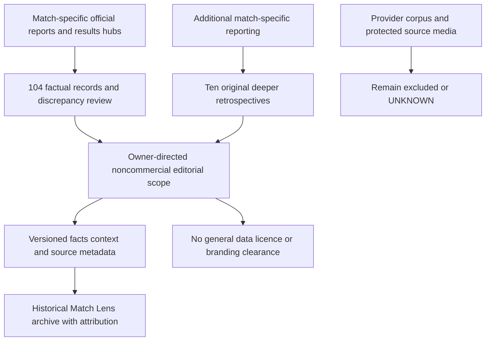

# Historical archive: source and publication review

Review ID: `wcl-curated-2026-v3`. Evidence access/review: **2026-11-07**. Decision: **OWNER_DIRECTED_EDITORIAL_RELEASE** for independently curated facts covering all 104 tournament matches, original retrospective copy and evidence metadata in this noncommercial public archive and source repository. This supersedes the earlier five-record internal scope; it is a project release decision, not blanket FIFA permission, an open-data licence or legal clearance.

No API-FOOTBALL response, Supabase export, publisher article body, PDF, photograph, crest, official logo, graphic, font or video is bundled. Plain team/venue labels and results are recorded separately from protected expression and media. Dataset versions are internal; the public product is simply World Cup Lens.

## Source coverage and verification

`src/data/curated-records.json` stores the factual records. Each has its own match-specific FIFA Training Centre PDF URL and evidence metadata. The review read the first page of all 104 official post-match reports, checking match number, source-local event day, teams, stage/group, result and venue. The direct [group-stage hub](https://www.fifatrainingcentre.com/en/fifa-world-cup-2026/match-report-hub.php) and [knockout hub](https://www.fifatrainingcentre.com/en/fifa-world-cup-2026/match-report-hub-knockout-stage.php) supplied a second official results representation. The [FIFA schedule/results page](https://www.fifa.com/en/tournaments/mens/worldcup/canadamexicousa2026/articles/match-schedule-fixtures-results-teams-stadiums) remained index-accessible where direct article bodies were unreadable; metadata records that weaker access method rather than claiming a retained full source snapshot.

| Stage | Records |
| --- | ---: |
| Group stage, twelve groups of six fixtures | 72 |
| Round of 32 | 16 |
| Round of 16 | 8 |
| Quarter-finals | 4 |
| Semi-finals | 2 |
| Third-place match | 1 |
| Final | 1 |
| Total | 104 |

The official match number is the stable tournament sequence, not an inferred kickoff time. Display sorting is event day then match number. No clock time is imported. The contract retains explicit unknown lineup, player-statistic, regulation-score, source-capture, model-generation and historical-cutoff fields.

Final goals and shootouts are separate. The four verified shootouts are Germany–Paraguay (match goals 1–1, penalties 3–4), Netherlands–Morocco (1–1, 2–3), Australia–Egypt (1–1, 2–4) and Switzerland–Colombia (0–0, 4–3). A goal from an in-match penalty remains part of the match score. Added time is not extra time. Knockout winner/participant continuity is checked without inventing a group tiebreaker model.

## Conflicts and normalization decisions

- **Match 75, Netherlands–Morocco:** the official recap describes a level 1–1 score after extra time and Morocco's 3–2 shootout win. A Sky aggregate's 2–2 value conflicts and was not adopted.
- **Match 91, Brazil–Norway:** FIFA's results and the CBF report support 1–2; a Sky aggregate's 0–2 value was not adopted. The record links the corroborating evidence.
- **Argentina–Switzerland:** July 11 is the source-local event day. Some European reports/publication dates say July 12. These are preserved as evidence notes, not silently reconciled with an invented kickoff/timezone explanation.
- **Norway–Senegal, match 41:** the official report/PDF locates the fixture in New York New Jersey on June 22. A secondary aggregate lists Toronto/June 23; that conflicting date/venue was not adopted.
- **Venue aliases:** the schedule labels Estadio Monterrey and New York New Jersey Stadium are the canonical public names. PDF labels Monterrey Stadium and New York/New Jersey Stadium are retained as source aliases. No venue-country field is inferred from a competition label.
- **England–Argentina:** a federation URL says quarter-final and one FIFA headline reverses the result. The competition/body/result evidence establishes a semi-final won 2–1 by Argentina. The narrative does not rely on the erroneous heading.

These checks establish the selected source evidence, not publisher infallibility or permanent URL availability. Source publication day is recorded only when established; access/review day does not become a capture instant. No source document is committed merely to make validation reproducible.

## Retrospective Match Lens coverage

`src/data/curated-history.ts` combines the facts with concise context: group fixture number and derived group records, or knockout stakes and the winner's subsequent opponent. It does not fill every card with a fabricated tactical account. `src/data/curated-lenses.json` contains ten deeper original retrospectives:

| Match | Editorial reason / additional evidence |
| --- | --- |
| Mexico–South Africa, June 11 | Tournament opener; [CAF account](https://www.cafonline.com/fifa-world-cup/news/south-africa-left-with-work-to-do-after-opening-defeat-to-mexico/) supports disciplinary context |
| USA–Paraguay, June 12 | Co-host's opening win; [U.S. Soccer recap](https://www.ussoccer.com/stories/2026/06/usmnt/folarin-balogun-brace-match-recap-highlights-vs-paraguay) supports the scoring sequence |
| Spain–Cabo Verde, June 15 | Debutant's point; [FIFA technical review](https://www.fifatrainingcentre.com/en/fifa-world-cup-2026/how-vozinha-inspired-cabo-verde-to-historic-draw-with-spain.php) supports a limited, attributed goalkeeping observation |
| Argentina–Cabo Verde, July 3 | Repeated equalisers; [CAF account](https://www.cafonline.com/fifa-world-cup/news/cape-verde-leave-world-cup-as-heroes-after-brave-argentina-battle/) supports the extra-time sequence |
| Norway–England, July 11 | Extra-time quarter-final; [England Football](https://www.englandfootball.com/england/mens-senior-team/fixtures-results/2025-26/World-Cup/norway-england-fifa-world-cup-quarter-final-saturday-11-july-2026-match-centre) supports the comeback and decisive goal |
| Argentina–Switzerland, July 11 | Extra-time quarter-final; [AFC account](https://www.the-afc.com/en/national/fifa_world_cup.html/news/q-final-argentina-3-1-switzerland-aet) supports late developments |
| France–Spain, July 14 | Final qualification and venue context; [Inside FIFA](https://inside.fifa.com/organisation/news/dallas-stadium-messi-haaland-unai-simon-record-spain-france) documents Dallas's role |
| England–Argentina, July 15 | Late semi-final turnaround; [England Football](https://www.englandfootball.com/england/mens-senior-team/fixtures-results/2025-26/World-Cup/england-argentina-fifa-world-cup-quarter-final-wednesday-15-july-2026-match-centre) confirms the sequence |
| France–England, July 18 | Ten-goal third-place match; [England Football](https://www.englandfootball.com/england/mens-senior-team/fixtures-results/2025-26/World-Cup/france-england-fifa-world-cup-bronze-medal-match-saturday-18-july-2026-match-centre) distinguishes the changing lead and in-match penalty |
| Spain–Argentina, July 19 | Title decider; [Inside FIFA](https://inside.fifa.com/organisation/news/spain-crowned-world-cup-2026-champions-new-york-new-jersey) supports the extra-time breakthrough |

Each source is linked, not reproduced. Developments have explicit supporting URLs; cautious editorial interpretation is separate. No manually authored record is called AI output, no legacy provider-generated prose is reused and no predictive probability or strength rating is supplied.

## Publication basis and remaining uncertainty

The current owner authorization expands intended editorial scope, not third-party legal permission. The actual acquisition source, [FIFA Training Centre terms](https://www.fifatrainingcentre.com/en/terms-of-service.php), was checked separately: it publishes the same general FIFA platform terms and conditional §6.4 website-display provisions. No distinct broader PDF/data redistribution grant was found. [FIFA's terms](https://legal.fifa.com/terms-of-service), §6.4, conditionally support attributed noncommercial website display with linkbacks and no implied endorsement. The [legal FAQ](https://inside.fifa.com/organisation/contact-fifa/legal-branding-and-rights), D–E, supports editorial noncommercial text/statistics while excluding protected media and third-party articles. The [2026 IP guidelines](https://digitalhub.fifa.com/m/3567360896991b48/original/FIFA-World-Cup-26-IP-Guidelines.pdf), printed pp18 and 21–22, specifically discuss descriptive apps and editorial schedule use. No five-match quantity limit was found. These conditions do not themselves certify this project or its name/domain.

Bare facts, original expression, contractual access terms, database extraction rights and trademarks are different questions. The [U.S. Copyright Office](https://www.copyright.gov/help/faq/faq-general.html) distinguishes facts from expression. [UK database-rights guidance](https://www.gov.uk/guidance/sui-generis-database-rights) identifies separate protection for investment in collecting/verifying/presenting contents; changing a schema does not automatically remove that issue. Territorial eligibility and any protected source database were not adjudicated here.

[GitHub's terms](https://docs.github.com/en/site-policy/github-terms/github-terms-of-service), D.3–D.5, require compatible hosting/fork rights. FIFA's website-display permission is not an express unrestricted dataset/fork licence. The release therefore relies on its narrowly defined independent factual/editorial character, with remaining source-distribution uncertainty recorded, rather than asserting that §6.4 automatically clears GitHub. No concrete source-specific ban on a bare score/team/day/stage/venue field was established in this review; that is not proof no rights claim could arise.

| Category | Current project decision | Boundary |
| --- | --- | --- |
| 104 independently verified factual records and original evidence metadata | OWNER_DIRECTED_EDITORIAL_RELEASE | Current noncommercial archive/source scope; no open-data or downstream commercial licence |
| Newly written retrospective commentary | Same scoped release | Original expression, attributed source facts, no publisher text or generated-output claim |
| Official media/marks and source creative presentation | Excluded | No photos, crests, graphics, PDFs, fonts, article bodies or video bundled |
| Provider exports, private documents/excerpts and cached AI corpus | Prior UNKNOWN/not approved retained | No rights upgrade or export |
| Product name/domain, portfolio-use classification, database/source/forking scope | Unresolved | Non-affiliation helps explain identity but is not definitive clearance |

Reassess before monetisation, sponsorship, branding changes, unrestricted licensing or reuse outside this scope; seek qualified legal assessment or rights-holder clarification where needed. No rights-holder enquiry was sent. The existing independent design, attribution, linkbacks and non-affiliation notice remain release conditions.

## Implementation and release evidence

Deterministic checks compare count/stage/result/source contracts and exercise navigation; they do not independently re-authenticate a publisher. Current code and SQL tests retain distinct public editorial and private RAG boundaries. CI, screenshots and production release status must be verified for the committed revision and recorded in [deployment](deployment.md); this source review does not assert a new deployment occurred.
