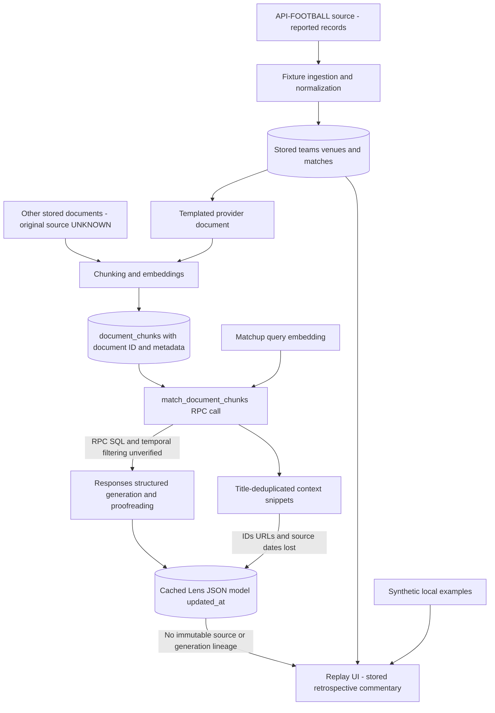

# Data provenance and historical time semantics

Historical evidence inspected 2026-11-03 against baselines `25d414e`/`5dff6a3`; the later original-demo replacement is distinguished below. This documents implemented transformations and explicit unknowns; it is not a verified historical source archive. Read [data rights](data-rights.md) before publication. The inventory includes existing illustrative examples but does not export provider records.

## Evidence from the application and cache

| Finding | Repository evidence | Consequence / presentation policy |
| --- | --- | --- |
| Fabricated strength defaults | `src/lib/fixtures/normalize.ts:normalizeApiFootballFixture`, `sync-fixtures.ts:syncWorldCupFixtures`: every strength is 50; `5dff6a3:src/data/seed.ts:teams/cachedLenses` had values such as 56/44; that legacy module is now replaced | No measured methodology or per-field source exists. All numerical Team Edges bars are removed from public presentation in both modes; unavailable is not zero/equality. Legacy stored fields remain unchanged. |
| Defaults become apparent evidence | `sync-provider-documents.ts:teamDocumentBody` embeds scores in a “Provider-derived” tactical profile with a caveat; `ai/prompts.ts:buildMatchLensPrompt` instructs exact edge values | Existing commentary may reason from placeholders. Keep prose unchanged, label it unverified stored commentary, and do not claim hiding bars repairs its factual grounding. |
| Non-calibrated opinions | `MatchLens.confidence/volatility/slightEdge` and `MatchForecastCard`, featured/list cards | Labels are now explicitly stored, uncalibrated opinions. Null edge means “No edge stated”, not “Even”. No probability or measured edge is inferred. |
| Context is not citations | `ai/source-snippets.ts:hydrateLensSources` attaches every distinct retrieved title, truncates content, drops IDs/URLs, and does not map claims to excerpts | UI says stored context snippets (illustrative context examples in synthetic mode), with a non-citation caveat and empty-context state. |
| Event time is not knowledge time | `Match.kickoffAt`, date selection, `generate-and-save-match-lens.ts:generateAndSaveMatchLens` writes wall-clock `updated_at` | The selected date filters fixtures; neither it nor kickoff nor last cache write authenticates a pre-kickoff forecast. |
| Unverified identity/geography/stage/results | `deriveTeamCode` appends external ID, `deriveFlag` uses finite aliases; venue country uses `league.country`; group/stage share `group_name`; writer discards penalty breakdown | Fixture fields are labeled stored provider records, not independent verification. No flags, venue country, result events, or stage correctness is repaired by AI prose. Existing score/status safeguards remain. |

Read-only sample: two provider-linked July 11 fixtures and two cached Lens rows were inspected with publishable access. All cached edge values in both samples were 50; prose contained placeholder/neutrality wording; each had four title/snippet sources without URLs. Both venue countries were `World`. Model and cache-update fields existed, but neither Lens supplied a knowledge cutoff or generation timestamp. These observations are limited to two samples and do not establish complete corpus origin, correctness, or rights. No raw cached prose, source export, or identifying record dump was added to the repository.

## Source inventory

| Category | Actual source / identity | Fields and classification | Verified implementation / unresolved boundary |
| --- | --- | --- | --- |
| Fixtures and results | [API-FOOTBALL / API-SPORTS](https://www.api-football.com/documentation-v3); configured `/fixtures` feed | IDs, kickoff, round, provider state/elapsed, goal totals; provider-reported factual records | `fixtures/api-football.ts`, normalization and upsert. Original payload/source capture is not retained by this writer; real-world accuracy unverified. |
| Team identity and logos | Same provider for numeric ID/name/logo URL; app's `sync-fixtures.ts` for codes/emoji | Mixed factual labels and derived identifiers; logo is branded media | Provider code is not used directly; codes are app-generated. Logos are stored externally as URL references, not part of `Team` display mapping. Flag overrides/fallbacks are application choices, not verified provider flags. |
| Venues | Provider `fixture.venue` plus app fallback strings and league country | Name/city/ID, synthetic fallback labels, possibly inappropriate country | `normalizeApiFootballFixture` maps null IDs to fallback slugs; country is competition geography, not independently sourced venue geography. |
| Provider-derived documents | `documents/sync-provider-documents.ts:teamDocumentBody/venueDocumentBody` | App-authored templates about provider rows; placeholder metrics, not independent tactical research | Upserted `documents` with null `source_url`; not an external publisher endorsement. Existing entity/type document IDs can be reused. |
| Editorial or curated snippets | `src/data/seed.ts`; otherwise bodies already in Supabase `documents` | Synthetic editorial examples, templated profile excerpts, or UNKNOWN origin | No tracked article importer or Q&A writer. A title such as “Tournament format” is not proof a publisher document exists. No external source identity can be invented from it. |
| Cached AI Lens | OpenAI Responses + supplied team/venue/context in `ai/generate-match-lens.ts` | Model-generated interpretation with deterministic snippets; confidence/volatility are editorial labels | `generateAndSaveMatchLens` persists JSON/model/update per match; no immutable input/source/prompt lineage is saved. Proofreading is another model call. None were executed for this milestone. |
| Cached Q&A | Seed examples, or Supabase `qa_answers` | Editorial/cached text; model-generated origin for arbitrary DB answers UNKNOWN | Public code only reads/validates answers. It does not generate them. |
| Current illustrative fixtures/examples | Replacement `src/data/seed.ts`, version `wcl-synthetic-v2` | Newly authored fictional teams, locations, styles and Q&A, alphabetic initials, null strengths, no real outcomes | Scoped new original-demo publication review; not the old UNKNOWN illustrative corpus in Git history. |

Rights/attribution and separate GitHub-versus-web decisions for these categories are in [data-rights.md](data-rights.md). The runtime review registry `src/lib/data-rights.ts` keeps the eight legacy/provider categories UNKNOWN/NOT_APPROVED/REVIEW_REQUIRED. The reviewed-synthetic-demo-v1 category has original-demo approval; curated-history-2026-v1 has a separate owner-directed five-record editorial decision, not blanket licensing. It is not an exporter or a rights-enforcement service.

## Implemented temporal representation

`src/lib/analysis-presentation.ts:analysisProvenance` creates a read-only display representation; it does not write or backfill any database fields. `PublicMatchLens` excludes unsupported `teamEdges` from the UI type; the legacy generation/storage `MatchLens` contract remains. Public cache validation checks the displayed text, enums, arrays and snippets, while ignored missing/malformed legacy metrics cannot hide otherwise readable qualitative copy. This does not validate truth or citations.

| Concept | Current representation | What it establishes / does not establish |
| --- | --- | --- |
| Match event time | `matchEventAt` from recorded `kickoffAt`, offset-bearing ISO timestamp or null | Scheduled/event reference from a stored fixture; not proof of actual whistle time or when a source was known. |
| Source publication time | `sourcePublishedAt: null` | UNKNOWN. No value inferred from document insertion, title, or kickoff. |
| Source capture time | `sourceCapturedAt: null` | UNKNOWN. A document/cache update is not evidence of acquisition time. |
| Analysis generation time | `analysisGeneratedAt: null` | UNKNOWN. Model name and cache `updated_at` do not prove request completion time. |
| Historical knowledge cutoff | `knowledgeCutoffAt: null` | UNKNOWN; existing archive commentary is always retrospective, never promoted into an authenticated pre-kickoff forecast. |
| Dataset version | Archive: `datasetVersion: null`; new illustrative module: `wcl-synthetic-v2` | The authored module has an explicit version. A Git commit or selected date does not identify an archive database snapshot. |
| Cache last-write time | `cacheUpdatedAt` from `match_lenses.updated_at`, if valid | Separate, labeled cache modification time only. It may be missing/invalid; that does not fabricate a timestamp. |

The UI shows these distinct fields on Lens detail. Timestamp parsing requires a full ISO timestamp with offset and a valid calendar date. New illustrative metadata is labeled synthetic and distinguishes authored copy from model generation; its fixture time does not become real event provenance. Inputs that claim a cutoff/version are not promoted by this legacy display adapter. Source URLs/IDs/timestamps are absent from cached title/snippet references and remain unresolved.

## Actual pipeline and missing lineage

The RPC implementation is not tracked. There is no source-publication cutoff argument in `retrieveMatchContext`; entity IDs and similarity are not historical eligibility. Snippets are attached deterministically after generation rather than per claim. The cache upsert overwrites per match and loses prior versions. The diagram describes code calls, not verified infrastructure or a guarantee that all stored documents followed this pipeline.

## Proposed provenance contract — not migrated or backfilled

Design a reviewed, immutable contract before making authenticated historical forecasts or exporting data:

- **Source revision:** stable source ID, publisher/rights-holder ID, canonical URL where known, content hash, publication and capture times with timezone and evidence, source kind, explicit unknown values, and a rights-review ID. Revisions do not overwrite original evidence.
- **Rights decision:** distinct permissions for web display, dataset redistribution, snippet use, embeddings, and retention; status UNKNOWN/PENDING/APPROVED/REJECTED; evidence reference, approved scope/attribution/expiry, reviewer and review time. An unknown upstream decision propagates to derived content; it is never converted by inference.
- **Document/chunk revision:** source revision and transformation/version, document hash, chunk ID/hash/index/span, embedding model/dimensions/chunker version. Preserve identity through retrieval; do not use a title as an ID.
- **Retrieval/generation record:** source/chunk revision IDs, retrieved query and entity scope, requested/effective cutoff and eligibility evidence, prompt/schema/model versions, actual generation start/completion times, output hash and immutable run ID. A cache write timestamp remains separate.
- **Dataset manifest:** immutable dataset ID/version/hash, included entity/source/output revisions, event-date range, selection timezone, rights decisions and permitted audience. Avoid copying restricted content into a public manifest.
- **Claim support:** optional explicit claim IDs tied to excerpt/span evidence and review status. Being retrieved does not count as support; absence stays unverified.

Migration proposal: inspect/export schema definitions through authorized evidence first; review additive version/source/run/rights tables, constraints, foreign keys, RLS and query/index design in a disposable database. Backfill only facts established by existing evidence. Legacy rows retain null publication/capture/generation/cutoff/version fields; `updated_at` may populate only cache-write metadata. Do not regenerate Lenses to manufacture history. Add eligibility tests excluding material not demonstrably available by an authenticated cutoff before enabling any forecast label. Production migration/backfill and any dataset export require separate explicit authorization and rights review.

## Public demo boundary and source replacement

The baseline seed's real-team/profile-like copy could not be cleared, so it was replaced instead of automatically approved. The new authored module uses no provider records or third-party excerpts; [demo-publication-review.md](demo-publication-review.md) records exact scope and evidence. Commentary in this version is stored sample copy, not a paid generated Lens. Scenario times are navigation values, unknown strengths remain null, and no official outcome is represented. Original design notes are not publisher citations.

`WCL_DEPLOYMENT_MODE` defaults/fails closed to demo-only. That branch now defaults to the five curated historical records, with reviewed fiction explicitly selectable, rejects explicit archive URLs, and guards all authoring endpoints before auth/work. Archive-enabled is an explicit separate server configuration; its source/time/rights limitations above remain unchanged. Backend connectivity and permission to publish historical material are not prerequisites for demonstrating this original UI dataset. No source acquisition, migration, production write, or historical export was performed for the replacement.

## Independently curated history — implemented date-only contract

[Curated review](curated-history-review.md) records the owner's narrow editorial release decision, exact five tuples, primary URLs, federation cross-checks, 2026-11-03 review/access days and remaining rights/branding uncertainty. These facts were independently selected from published official evidence; no API-FOOTBALL or production Supabase records were inputs. Newly written agent-assisted editorial copy is separate from Match Lens pipeline output, does not reproduce publisher wording and makes no unsupported tactical or predictive claim.

| Concept | Curated representation | Meaning |
| --- | --- | --- |
| Event day | `eventDate`, `datePrecision: day`, `dateBasis: source-local-event-day` | Reviewed source's event day, not a UTC instant or inferred kickoff. No Los Angeles conversion is applied to a date-only fact. |
| Clock time/events/statistics | `unknowns.kickoffAt`, `lineups`, `goalMinutes`, `formations`, `possession`, `playerStatistics`, `regulationScore`: null | Outside this independently curated selection; no inferred values. |
| Publication day | `source.publicationDate`, day or null | Known article day, separate from event day; no precise publication instant claimed. |
| Evidence access/review | `source.accessedOn`, `reviewedOn`, `accessMethod` | Human/agent review calendar days, not a source capture timestamp. PDF read directly versus indexed official article evidence is explicit. |
| Source capture | `unknowns.sourceCapturedAt: null` | No retained source snapshot/hash or exact capture instant. URLs may change. |
| Analysis generation | `unknowns.analysisGeneratedAt: null`; `commentaryOrigin: authored-retrospective-editorial` | Repository-authored context; no Match Lens model run to timestamp. |
| Historical cutoff | `unknowns.historicalKnowledgeCutoff: null` | No genuine as-of forecast claim. |
| Dataset version | `wcl-curated-2026-v2` and scoped `CURATED_PUBLICATION` | Exact five-record module, not a complete tournament/provider database or general rights approval. |

Source links identify evidence for the limited match facts, not claim-level authentication of every editorial inference. FIFA explicitly identifies Argentina–Switzerland's July 11 local event day; its article publication is July 12 and UEFA lists July 12. Both metadata and discrepancy are preserved without inventing a kickoff/timezone explanation. Two group fixtures have no extra time; three knockout results include AET. Regulation and shootout breakdowns are not inferred.

The separate type and fail-closed validator are in `src/lib/curated-history.ts`; reviewed records are in `src/data/curated-history.ts`. Public list/detail loaders never combine curated and fictional/provider rows. The [worked match example](architecture.md#curated-history-contract-and-worked-example) follows a record into the UI. Future private archive lineage/schema proposals above are unchanged and unimplemented; this local module does not backfill the database.

## Editorial copy revision v2

The redesign increments the curated and fictional module versions because displayed authored copy changed. All five curated factual tuples, stable IDs, source evidence dates and unknowns are unchanged. Short recaps replace repetitive methodology prose; source/evidence limitations move into match disclosures and About. Fictional descriptions replace analogies with assigned-style descriptions. Existing Supabase Lens/Q&A wording is preserved, and no generation, ingestion, embedding or database operation is part of this revision. See [design decisions](design.md).
