# Data provenance and historical time semantics

This inventory separates public editorial records, synthetic examples and private provider/model data. It describes current code and the limited legacy sample inspected on November 3, 2026. Publication decisions are recorded separately in [data rights](data-rights.md).

## Source inventory

| Category | Source and fields | Implementation and evidence boundary |
| --- | --- | --- |
| Curated historical records | Official FIFA reports/results with federation cross-checks; event day, teams, stage, venue, score, AET and source metadata | `src/data/curated-history.ts`, validated by `loadCuratedHistory`. Exactly five selected records; [source review](curated-history-review.md) records direct-PDF versus indexed-text access and the event/publication-date discrepancy. No provider export is an input. |
| Original historical commentary | Retrospective summaries grounded in the selected results and progression | Stored with the curated module, separate from the application's Match Lens pipeline. No player statistics, tactical measurements or forecast is supplied. |
| Public fictional lab | `src/data/seed.ts`, version `wcl-synthetic-v2`; invented teams, venues, scenario styles and stored Q&A | Explicit fiction with null strengths and no real outcome. Scenario notes are original sample context, not external citations. [Publication review](demo-publication-review.md). |
| Provider fixtures/results | [API-FOOTBALL / API-SPORTS](https://www.api-football.com/documentation-v3) fixture feed; provider IDs, kickoff, round, raw status, elapsed and goals | `fixtures/api-football.ts` and `syncWorldCupFixtures`. Raw provider payload/capture history is not retained by this writer. Reported fields are not independently verified facts. |
| Provider teams/logos | Provider team ID, name and logo URL; application-derived code/flag | `deriveTeamCode/deriveFlag` use local rules. Logos are stored as external URL references and are not rendered by the replay's `Team` mapping. Alias accuracy and media rights remain unresolved. |
| Provider venues | Fixture venue ID/name/city; application fallback labels | `normalizeApiFootballFixture` uses Unknown for country because the response lacks venue-country data. Legacy rows may still contain competition country such as World. Missing-ID fallback slugs can collide. |
| Provider-derived documents | `sync-provider-documents.ts:teamDocumentBody/venueDocumentBody` | Application templates about stored provider fields, not independent tactical research. Current templates omit placeholder strengths, use stable scoped IDs, retain unchanged capture clocks and leave publication time unknown. Source URL is null. |
| Other private documents/excerpts | Bodies already stored in `documents`; source origin may be UNKNOWN | No external-article importer is tracked. Titles alone do not identify a publisher or establish excerpt rights. New versioned context retains document/chunk identity separately from display excerpts. |
| Legacy cached Lens | Existing `match_lenses` JSON/model/update rows | Compatible prose is read as stored retrospective AI commentary. Old inputs, generation clocks and historical cutoffs are not authenticated; prior output may rely on placeholder metrics. |
| New versioned Lens | `generateAndSaveMatchLens` → `runVersionedLens` → `commit_lens_generation` | Immutable input/source/run history, prompt/schema/model labels and distinct clocks. Core behavior is mock-tested and SQL is exercised directly; complete vendor/gateway execution and grounding quality are unverified. |
| Cached Q&A | Original fictional module or private `qa_answers` rows | Public code reads/validates answers. No private Q&A generation writer is tracked; origin of arbitrary database answers is UNKNOWN. |
| Integration corpus | `supabase/seed.sql`, SQL assertions and deterministic test fixtures | Original synthetic text and basis vectors labeled synthetic; no production rows, provider responses or external excerpts. The corpus is separate from the public fictional module. |

`src/lib/data-rights.ts` records scoped decisions, not automatic licence validation or export authorization. The original legacy/provider categories retain UNKNOWN rights; curated and original-fiction approval applies only to their specified versions and uses.

## Legacy evidence and presentation

A November 3 read-only sample contained two provider-linked July 11 fixtures and two Lens rows. Both cached edge sets were all 50, prose referenced neutral/placeholder inputs, sources were title/snippet pairs without URLs, and venue country was World. Model/cache-update fields existed; generation and cutoff evidence did not. These observations cover only that sample; no row/prose export was committed.

The legacy implementation assigned 50 to unknown strengths, repeated them in documents and required numerical edges in generated output. Current ingestion stores null, current templates omit those metrics and new generation requires empty `teamEdges`. Existing database prose was not rewritten or regenerated. Withholding bars does not repair unsupported reasoning in old text.

`PublicMatchLens` omits numerical comparisons. `MatchLensCards` labels archive context as stored snippets and fictional context as Scenario notes. Archive forecast labels are uncalibrated opinions; fictional detail omits those forecast cards. Missing or malformed hidden metrics do not suppress otherwise compatible qualitative text. None of these display checks establishes factual support for a claim.

## Legacy replay time representation

`analysis-presentation.ts:analysisProvenance` is a read-only display adapter. It does not backfill source or generation metadata from a cache timestamp.

| Concept | Legacy replay representation | Meaning |
| --- | --- | --- |
| Event reference | `matchEventAt` from a valid offset-bearing `kickoffAt`, else null | Recorded fixture reference, not proof of actual whistle time |
| Source publication/capture | `sourcePublishedAt/sourceCapturedAt: null` | Unknown; not inferred from insertion, title or kickoff |
| Generation completion | `analysisGeneratedAt: null` | Model label/cache update is insufficient evidence |
| Historical cutoff | `knowledgeCutoffAt: null` | Cached archive commentary remains retrospective |
| Dataset version | Archive null; fictional module `wcl-synthetic-v2` | A selected day or Git commit is not a database snapshot |
| Cache modification | `cacheUpdatedAt` when valid | Last-write metadata only |

Curated history uses a separate date-only contract. It preserves the source's event day without creating a kickoff instant. The Argentina–Switzerland record distinguishes FIFA's July 11 event day from the July 12 publication day and UEFA entry. Fictional timestamps are navigation examples; neither they nor the replay selection become historical knowledge cutoffs.

## Current versioned pipeline

```mermaid
flowchart LR
  Source[Source identity and availability evidence] --> Ingest[Private ingestion or original synthetic seed]
  Ingest --> Document[Document input hash and metadata]
  Document --> Version[Immutable document version]
  Version --> Chunk[Immutable chunk hash and embedding version]
  Chunk --> Retrieval[Entity and optional cutoff eligibility]
  Retrieval --> Generate[Structured generation and final validation]
  Generate --> Cache[Immutable run and versioned cache]
  Cache --> Adapter[Private retrospective Lens adapter]
  Adapter --> UI[Archive replay subject to grants and RLS]
  Legacy[Legacy unknown metadata] -. not backfilled .-> UI
```

New document versions preserve source/provider identity, material, scope and availability metadata. Chunks retain embedding labels and content hashes. Runs retain the exact match input, retrieved identities, query, prompt/schema/model versions, execution clocks and output hash. The [database contract](database-contract.md) and [RAG pipeline](rag-pipeline.md) define these fields and transaction boundaries.

As-of eligibility requires established publication and capture at/before cutoff plus an exact input-fingerprint attestation. Source edits clear prior availability review. Attested available-at and actual attestation recording time are distinct; operator assertions do not authenticate publisher clocks or model compliance. The HTTP authoring adapter and legacy replay remain retrospective.

The reconstructed SQL has not been installed in production. It defaults provider/source/history rows private, so the existing publishable provider reader cannot expose them. The public demo reads reviewed local records instead.

## Final normalization corrections

`normalizeApiFootballFixture` maps supported provider statuses through `canonicalFixtureStatus` and rejects unsupported or ambiguous states before a batch write. Missing venue country is Unknown rather than competition country. Deterministic regressions cover these corrections; existing production rows were not rewritten. Stable team/venue identity, flag aliases, group-stage updates and penalty breakdown remain [private-ingestion work](roadmap.md#true-defects--private-ingestion).

## Remaining provenance work

- Authenticated source evidence and rights-holder/review references, including publication, capture and retention permissions.
- Immutable dataset manifests identifying the selected input/source/output revisions and permitted audience.
- A reviewed operator procedure for attesting exact input availability.
- Claim-level support records and grounding evaluation; retrieval membership alone is insufficient.
- An authorized production schema comparison and migration/backfill proposal. Unknown legacy fields stay null unless evidence establishes them; generation cannot be rerun merely to manufacture history.

No historical/provider export is approved by the existence of this schema. See [rights decisions](data-rights.md) before publication or reuse.
