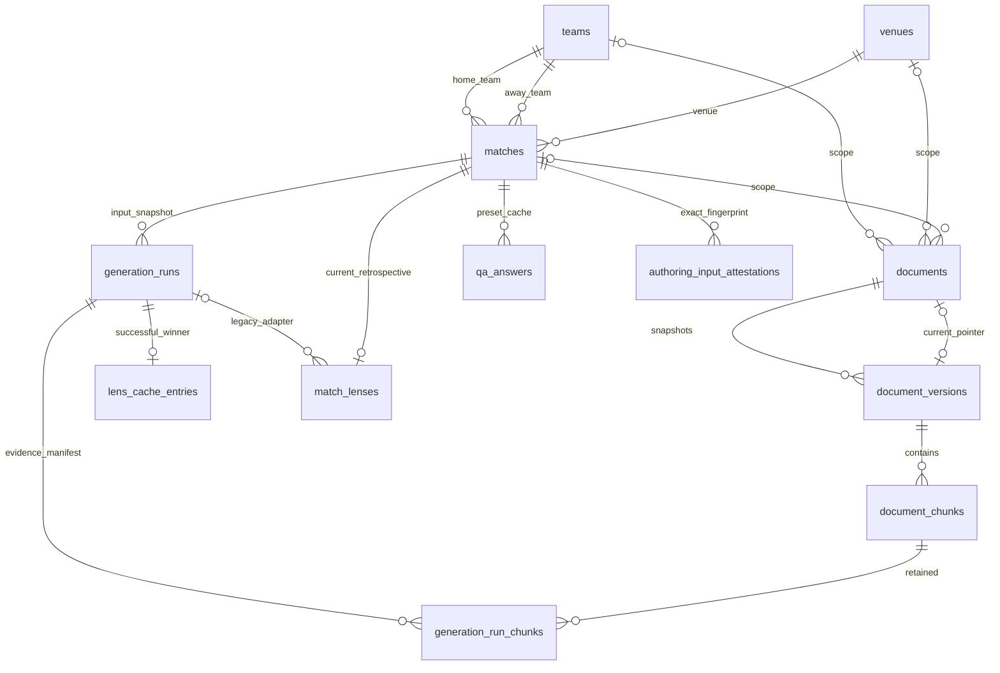

# Disposable database contract v1

## Evidence and scope

On 2026-11-04, read-only PostgREST OpenAPI discovery with the configured privileged client returned HTTP 200. It exposed the seven legacy tables below, text team/venue/match IDs, UUID document/chunk IDs, `extensions.vector(1536)`, and `match_document_chunks`. A publishable-key discovery request returned 401; this is not an empty database result. No production rows were exported, no SQL catalog/function body was available, and no production migration was applied.

**Verified:** exposed column names/types. **Application-inferred:** conflict targets, named FK joins, required RPC arguments and return fields. **Reconstructed:** every SQL constraint, grant, policy, index, function body, and new version/history structure in `supabase/migrations/`. This is a clean-database contract, not a production schema dump or a safe incremental upgrade of that project.

## Bootstrap and checks

```sh
npm run db:bootstrap
# Same disposable bootstrap plus assertions:
npm run db:test
```

Both commands create, migrate, seed, test and destroy an owned database. They never accept a connection URL or load `.env` files. On Docker-capable machines the runner uses `pgvector/pgvector:0.8.2-pg17`, no network and no published port. On this Mac it uses Homebrew PostgreSQL 14 binaries and installed official pgvector 0.8.2, a private temporary Unix socket and no TCP listener. `WCL_PG_BIN` may select installed PostgreSQL binaries; they must already have pgvector installed. No package installation is performed by the runner. Database processes, readiness and query calls have deadlines; cleanup targets only the owned cluster/container.

`supabase/config.toml` is an optional Supabase CLI adapter (`supabase start`, then `supabase db reset`, **local only**). That complete CLI/Auth/PostgREST stack was not exercised here. The Node runner is the tested path. Never run `db push`, link this reconstruction to production or reuse production credentials for tests. The runner supplies non-login roles, including a `NOBYPASSRLS` service role, before applying SQL; Supabase normally provides those roles itself.

## Tables

Read the migrations for exhaustive declarations. All clocks are `timestamptz`; no date-only curated record enters these tables.

| Table | Contract |
| --- | --- |
| `teams` | Text `id` PK; nonempty `name`; text `code/flag/group_name/summary` default empty; nullable smallint `strength_attack/midfield/defense/transitions` constrained 0–100, **no placeholder default**; nullable provider identity/logo; timestamps default now |
| `venues` | Text `id` PK; nonempty name; text city/country default Unknown, summary empty; nullable external provider/id; timestamps |
| `matches` | Text PK; nonnull text team/venue FKs with the three exact names used in `repository.ts`; nonnull `kickoff_at`; `group_name` empty default; `signal_tags text[]` empty default; canonical status enum-check/default scheduled; nullable provider status text, elapsed 0–300, scores 0–99; nullable paired `known_at/knowledge_evidence`; timestamps; distinct opponents |
| `documents` | UUID PK default random; title 4–100, type/body; nullable source URL/identity/provider and entity FKs; explicit `is_global=false`; source kind; nullable publication/capture/evidence; `availability_verified=false`; dataset version; trigger-computed SHA256 input hash; current version pointer; timestamps |
| `document_versions` | UUID PK; parent UUID FK; immutable snapshot of text, source identity/provider, entity scope and temporal metadata; hash/version key; embedding model/logical version/origin; chunker version; actual embedding start/completion; unique `(document_id,version_key)` and `(document_id,id)` |
| `document_chunks` | UUID PK; document FK and optional version FK (nullable only for legacy compatibility); nonnegative index; nonempty content; generated SHA256 content hash; nonzero vector(1536); JSON-object metadata; model/version; timestamp; unique version/index and partial legacy document/index |
| `generation_runs` | UUID PK supplied by client; match FK; cache key; canonical identity/submission; immutable full input snapshot/fingerprint; dataset/prompt/schema/model/embedding versions; perspective/cutoff; retrieval and actual generation clocks; query vector; ordered source manifest; success/failure, validated final Lens or safe error code; generated output hash |
| `generation_run_chunks` | Immutable run/chunk FK pair PK; unique run/position preserving retrieval order |
| `lens_cache_entries` | Cache key PK; composite FK to matching successful run; first winner retained; service cannot update/delete pointers |
| `match_lenses` | Legacy unique match adapter (match ID PK in reconstruction); JSON object, model, generation FK, update timestamp; UUID identity and creation timestamp retained for compatibility |
| `qa_answers` | Composite match/question PK, restricted three preset keys; JSON object; UUID identity, optional model, timestamps. Legacy Q&A is not retroactively assigned generation lineage |
| `authoring_input_attestations` | Immutable match/fingerprint PK, available-at, evidence, actual recording clock; operator attestation of **exact** input snapshot, not an automatically inferred timestamp |

The five readable presentation tables also have `data_origin` (default unknown) and `publication_status` (default private). Only the conjunction synthetic + synthetic-public qualifies for anonymous reads. Provider IDs have unique `(external_provider,external_id)`; null identities can repeat. Source provider/team and provider/venue document identities have partial unique indexes. Fixture date/provider, FK lookup, current chunk version/model and match generation history indexes support the current queries. No approximate vector index is introduced; exact filtered cosine retrieval preserves deterministic semantics on this small corpus.



## Functions and transaction boundaries

- `backend_contract_version() → integer`: explicit compatibility preflight, currently 1.
- `authoring_match_input(text) → jsonb`, `authoring_input_fingerprint(text) → text`, `get_authoring_input(text) → jsonb`: privileged single-query snapshot/fingerprint. UTC serialization removes session timezone ambiguity.
- `pending_embedding_documents(text model,text version,text chunker) → setof documents`: at most 50 stale/missing heads ordered by creation/ID; unchanged records are skipped.
- `store_document_revision(uuid,text expected_hash,text model,text version,text origin,text chunker,timestamptz started,timestamptz completed,jsonb chunks) → uuid`: locks document, rejects stale input, atomically inserts immutable version and all chunks then advances head. Invalid batch rolls back everything. Identical inputs/chunks reuse a version. Old chunks are never deleted.
- `match_document_chunks(vector,float8 threshold=.15,int count=8,text[] teams=null,text venue=null,text match=null,timestamptz cutoff=null,text model='text-embedding-3-small',text version='openai-small-1536-v1')`: [retrieval semantics](retrieval-design.md).
- `get_cached_lens(text cache_key) → jsonb`: private single-query successful cache read.
- `commit_lens_generation(jsonb envelope) → uuid`: locks match without blocking FK key-share checks, locks team/venue and selected source heads, checks input fingerprint, recomputes retrieval at persistence snapshot, validates shape, inserts run/bridges/cache/legacy adapter in **one transaction**. Same run ID + identical envelope is retryable, including concurrent retries. Conflicting envelope fails. All attempts remain immutable; failed runs never advance cache. As-of output never overwrites retrospective adapter.

Fixture teams, venues and matches still upsert in separate HTTP transactions. Provider-document sync is likewise not one corpus transaction. A later failure does not undo earlier successful steps; rerun is idempotent by stable identities. Generation HTTP/model work cannot participate in a database transaction. There is no durable job queue or exactly-once external-call guarantee. See [failure recovery](rag-pipeline.md).
