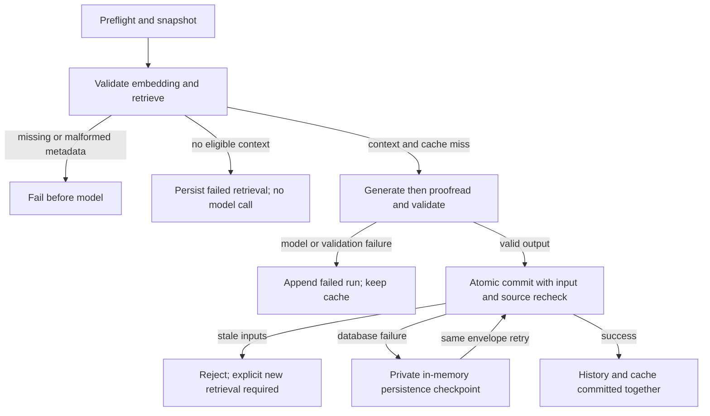

# RAG authoring and immutable cache

## Implemented path

`generateAndSaveMatchLens` is the server adapter; `rag/engine.ts:runVersionedLens` is the dependency-injected core. Public pages import neither generator. Every public authoring route still denies demo-only before authentication or work. This milestone uses **mock model/embedding responses only**; no real embedding/generation or provider API was invoked.

```mermaid
sequenceDiagram
  participant Operator
  participant Adapter as Private server adapter
  participant DB as Postgres invoker RPCs
  participant Core as Versioned engine
  participant Model as Injected model or mock
  Operator->>Adapter: Explicit authorized authoring request
  Adapter->>DB: Contract preflight and get_authoring_input
  DB-->>Adapter: Snapshot and fingerprint
  Adapter->>Core: Versioned dataset and model configuration
  Core->>Model: Query embedding adapter
  Model-->>Core: Validated 1536 vector
  Core->>DB: Entity and cutoff filtered retrieval
  DB-->>Core: Current immutable chunk versions and metadata
  Core->>DB: Cache identity lookup
  alt Valid cache hit
    DB-->>Core: Existing validated output; no generation
  else Empty context
    Core->>DB: Failed retrieval record; no generation timestamps
  else Cache miss with evidence
    Core->>Model: Structured qualitative generation
    Model-->>Core: Schema-parsed draft
    Core->>Model: Proofread prose only
    Model-->>Core: Corrected text
    Core->>Core: Hydrate excerpts, normalize, final schema and identity validation
    Core->>DB: Atomic append and cache commit
    DB-->>Core: Stored run ID or safe failure
  end
```

The query names teams, stage and venue without Group-prefix assumptions. Prompt input is explicitly allowlisted. Retrieved text is untrusted data and cannot supply instructions. This reduces prompt-injection exposure; it is not a proof of resistance or factual grounding. Numeric edges are always empty for new output. Ingestion stores unknown strengths as null, source synthesis omits legacy placeholder measurements, and prompts do not receive raw team summaries/ratings.

Structured Responses and proofreading are still potentially paid adapters, available only for separately authorized private operation. Final validation runs **after** proofreading, source hydration and whitespace normalization. It rejects unknown keys/enums, invalid lengths/arrays, unsupported metric entries and opponent-name mismatches. SQL independently checks complete final Lens shape and identities before persistence. Generated source entries are replaced with at most five document-deduplicated excerpts, each <=180 characters; full ordered chunk metadata is retained privately. This proves shape and traceability, not the truth of every sentence. Historical corpora/legacy outputs may still contain unsupported claims and retain UNKNOWN publication rights.

## Versions, clocks and cache identity

| Concept | Representation |
| --- | --- |
| Match event | `matches.kickoff_at`; curated public date-only records remain completely separate |
| Source publication/capture | Nullable document fields; verified flag and evidence required for cutoff eligibility |
| Document/chunk version | Immutable UUIDs, input/content hashes, current pointer; old revisions retained |
| Embedding | Model label, logical embedding version, dimensions, origin, chunker version and actual start/completion |
| Retrieval | Actual injected/current clock, query/vector, filters/parameters and ordered manifest |
| Knowledge cutoff | Nullable timestamp distinct from all other clocks; perspective explicitly retrospective/as-of |
| Match-input availability | Immutable attestation of exact fingerprint, available-at/evidence and actual recording timestamp |
| Generation | Actual start/completion; null only when empty-context prevented generation; generator kind mock/model |
| Prompt/schema/model | Logical prompt/schema versions, requested model label; provider response IDs/model labels recorded in submission when available |
| Output | Immutable run UUID, generated output hash, cache key; legacy adapter's updated_at remains a cache timestamp |

Logical versions are application contracts, not authenticated vendor weight revisions. Requested model aliases can change upstream; response metadata does not establish model training cutoffs. As-of mode filters input evidence and requires exact input attestation, but does not prove model compliance or constitute a certified historical forecast. The public legacy UI remains retrospective; the private HTTP adapter defaults retrospective and does not expose an as-of switch. No old timestamp/identity is invented or backfilled.

Cache identity is SHA256 of deterministic canonical JSON containing contract/dataset/input fingerprint, allowlisted input, perspective/cutoff/attestation, model/generator kind, prompt/schema/embedding versions, query/vector/threshold/count and ordered source metadata. Changing source content, provenance, input or configuration changes the key. Retrieval clocks/run IDs are excluded. This checks evidence before deciding freshness, so even a cache hit currently incurs a query embedding in actual private operation; query-embedding memoization is deferred. No per-page generation occurs.

```mermaid
flowchart LR
  Source[Source and capture metadata] --> Head[Mutable document head with input hash]
  Head --> Atomic[Atomic revision and chunk write]
  Atomic --> Versions[Immutable document versions and chunks]
  Versions --> Retrieval[Filtered ordered retrieval]
  Input[Exact input snapshot and versions] --> Identity[Canonical cache identity]
  Retrieval --> Identity
  Identity --> Hit{Valid cache entry?}
  Hit -->|yes| Read[Read stored output]
  Hit -->|no| Validate[Mock or authorized model then final validation]
  Validate --> Runs[Append immutable run and chunk references]
  Runs --> Winner[First successful cache winner]
  Winner --> Legacy[Private retrospective match_lenses adapter]
  Legacy --> Replay[Existing archive replay read subject to RLS]
```



## Failure and concurrency



A successful model response followed by failed persistence raises `PersistenceFailure` containing the exact private envelope. An authorized caller can retry `commit_lens_generation` without another model call; identical run ID/envelope is idempotent, including concurrent retries. The checkpoint is not logged or sent from routes. It is not durably journaled: process loss can lose it and cause later repeated paid work. Durable jobs/outbox/retry tooling are deferred. Invalid/stale envelopes are not blindly retried.

The match lock serializes cache commits for that match. Multiple successful attempts may remain in history; the first successful identical-key cache pointer wins. The server adapter reads that winner back for its response, while each attempt output remains in history. The legacy pointer is updated atomically only for retrospective success and is reset private, never automatically publishing AI prose. Failed generation/persistence leaves previous cache intact. Document replacement is likewise atomic and never deletes old chunks. No whole-pipeline transaction or exactly-once model-call guarantee is claimed. `refresh` remains accepted by the legacy today API but cannot bypass a valid versioned cache or delete history; bump an explicit input/version for a distinct run.

## Complete synthetic worked example

1. `supabase/seed.sql` creates **Maple Eleven–Harbor Eleven**, `synthetic-match`, at fictional Test Ground, plus original source `00000000-0000-4000-8000-000000000001`. Its body says the team is fictional and lacks measured performance data. July availability clocks are explicitly fictional test assertions.
2. `store_document_revision` snapshots source/body/scope, hashes inputs, creates a chunk and points the head at the new immutable UUID. Embedding `[1,0,…,0]` is constructed locally and labeled synthetic-basis-1536/basis-v1. Revision/generation recording clocks are genuine execution clocks.
3. `match_document_chunks` with both team IDs, venue/match and the same basis query includes the Maple profile/global guide; another-match source is excluded. A July 10 cutoff also excludes unknown/later capture records.
4. `tests/rag.test.ts` injects a deterministic structured response: “A fictional matchup for the integration corpus.” Confidence Low, empty teamEdges, qualitative uncertainty and no invented result. Proofreading is mocked; source hydration and final checks execute actual code.
5. `supabase/tests/integration.sql:test_payload/test_lens` supplies the same qualitative output contract to the actual SQL commit. It stores exact input, ordered chunk/version identities, versions, mock generator kind, actual clocks and final hash. Assertions read `match_lenses` and `qa_answers` as anon **only after explicit synthetic-public marking**. Failed attempts and later source versions remain in history.
6. Production replay still reads its reviewed repository fiction, not this test database. Existing private archive Lens mapping can consume the legacy JSON adapter, but provider-filtered archive pages deliberately see no provider rows under the new RLS policy. There is no pretend provider ID or automatic publication bridge.

Unit engine and real SQL integration tests are complementary; the HTTP suites mock PostgREST, and the local PostgreSQL runner does not test the complete Supabase gateway. This is a tested foundation, not an assertion of production parity, verified football analysis or full end-to-end vendor integration.
